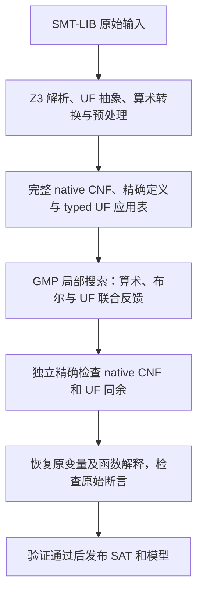

# UFNIA_LS 当前结构设计

**删缓存后全集复测（2026-11-12运行，2026-11-17终验）：** 当前f91cf2b7…无footprint缓存版本在node3全572例、每例端到端600秒、实际峰180，取得418个原式模型验证SAT／154timeout；运行exit0、独立审计eligible=true／issues=[]，无错误／OOM／漏跑，整轮1984.268664秒。较旧关闭缓存组419少1例：lia-splits/0052（旧426.910904秒SAT→本轮timeout），无新增；较旧full419少lia/0016。20240410为67／191；历史单轮70仍属于旧冻结版。输入SHA、参数及内存策略一致，但新脚本未显式记录PYTHONHASHSEED且单轮有时间／负载差异，不将1例差直接归因于删除缓存的实现错误。[完整报告](../result/best_node3_all_600_20261112_162503_JsIadn/REPORT.md)、[分族汇总](../result/best_node3_all_600_20261112_162503_JsIadn/summary.csv)、[逐例结果](../result/best_node3_all_600_20261112_162503_JsIadn/detailed.csv)。

**当前代码更新（2026-11-12）：** 用户根据全集消融决定移除footprint缓存。当前工作区已删除缓存表／共享句柄、查找插入／失效管理、环境开关及诊断字段，保留单自由根affine和原cache=0评分路径。每次仍构建足迹并执行域、数值预算、完整CNF／UF检查。运行脚本已同步；node2正常O2构建f91cf2b7…及8模块71项回归全过，node3脚本语法／dry-run通过；本次代码清理未重跑全集，419／419／413与历史70均继续归各自冻结版本。下文affine＋cache的实现描述及实验结论作为历史保留，不代表当前仍有缓存。

**最新全集组件消融（实验2026-11-11，终验2026-11-12）：** 同一a6二进制在node3顺序完成三组全572例、每例端到端600秒、seed0、实际峰180：full（affine1/cache1）419 SAT／153timeout；no_cache（1/0）419／153；no_affine（0/0）413／159。三组独立审计通过，输入／源码／二进制／内存profile一致，无error／OOM／漏跑。无缓存时affine新增9、丢失3、净增6；缓存新增lia/0016、丢失lia-splits/0052、净增0，共同418个SAT耗时比without/with几何均值1.030459。不能把缓存SAT总数相同写成集合相同，也不能将单轮耗时差当作稳定加速。组合PAR-2均值342.734790秒，基础352.498640秒，降低约2.77%。缓存依赖affine，故采用三组嵌套消融；完整报告见[QF_UFNIA组件消融实验报告.md](QF_UFNIA组件消融实验报告.md)。下文此前的单轮成绩和历史状态保留，不能代替本次同机同预算对照。

整理日期：2026-11-03。本文记录已经实现或尝试过的结构、做法、实验结论与限制，供后续修改算法时作为基线。尚未完成的工作统一放在[待尝试方向.md](待尝试方向.md)；编译、单例运行及历史 node3 正式轮复现命令见[实验说明](../docs/UFNIA_LS实验说明.md)。

**最新完整572例正式结果（2026-11-03）：** 当前清理版a6在node3实际跑完全572：419原式模型验证SAT／153timeout，572记录完整，无error／漏跑；实际峰180、每例端到端600，整轮1971.266秒。原批准独立审计actual exit0、eligible=true／issues=[]；与v12的572输入SHA相同，旧413→419，保留410／新增9／未复现3，净增6。20240410子集68／191，历史单轮最好70仍保留；未复现历史best的lia-splits/0035与0052。旧reserve48GiB、本轮24GiB，不把总耗时变化单归算法。[完整报告](../result/best_node3_all_600_20261103_161710_HtUKw3/REPORT.md)。下文“清理版尚无全量实测”等为此前阶段，当前419完整成绩归a6，历史70归原28cf。

**当前保留实现（2026-11-03）：** 按用户要求，主目录UFNIA_LS/mature已同步历史最佳70／191的单根affine＋精确cache；POINT死分支、member／输出后缀及三个专属源码文件已移除，affine/cache默认开启。Python默认后端仍为core，最佳运行参数为mature／uf-observers／joint／paws／seed0。主目录正常O2编译及原66＋新4共70项回归全过；两条旧补偿计数专测显式关闭affine，全部原assert保留，其余默认最佳。原最佳冻结目录和28cf0f1f…二进制完整保留，新清理binary a6e8de9a…只声明回归通过，不冒称重新取得191成绩。

**清理范围：** result/certora2024/research及除最佳之外snapshots中的7433个实验源码／脚本副本／构建文件／ELF和库已移除（2708268018字节），19513个结果／日志／报告、3symlink及最佳2783文件状态不变。保留此文的做法、负结果和研究方向；下文旧实现路径和source manifest属历史引用，非最佳实现可能已不存在，不能按旧路径继续运行。[完整清单与验证](../result/cleanup_best_20261103/REPORT.md)。

**阅读约定：** 第 1–7 节描述已经交付的 v12；第 8 节记录实验副本、负结果、已完成的诊断及尚未接入的原型。除已同步的单根affine和精确cache外，其余后续原型未合入当前算法；较差实现已按上方清理范围移除。历史全量正式成绩仍为 **413/572**；历史 500 SAT 目标未达到。**最新用户要求已改为：仅优化 `20240410-certora` 的完整 191 例，从 v12 继续，争取单配置 130 SAT；所有后续实验仅 node2、node3，每台最多 180 并行（新正式轮默认180），每例端到端 600 秒，不再短筛。** 本文后续 node4/5、180 并行及 30 秒筛选均为历史记录，不是当前授权。失败具体方案不原样重试，各配置独立计分。

**最新算法检查点（2026-11-02，条件两行完整轮已终审）：** 最好仍POINT-OFF70／191，目标130差60。条件两行补全ON69 SAT／122timeout、OFF70／121；保留69、新增0、丢失lia-splits/0052，OFF与历史best70集合完全相同。两原session实际exit0、完整191终态guard、两host源／快照／依赖／输入后检及原批准审计均通过，eligible=true、issues=[]；本具体配置关闭，不调cap／seed重试，不叠下一版。UF共同目标的人工资格和正常独立重建已通过，但新源码容量审计证明现全局预算预留会使部分真实规模输入在math前必拒，需先研究局部完整受影响闭包预算，尚无该原型的真实SAT收益结论。[最新完整对照](../result/certora2024/diagnostics/conditional_linear_completion_v1_600_comparison/REPORT.md)。

**最新检查点（2026-11-02，fresh-key正式轮已终审）：** 两原session55919／60346均已实际exit0；R3两host同机98资产及原来源、273external、191原式后检通过，两份原批准审计eligible=true、issues=[]。完整191／端到端600为FUE ON67 SAT／124timeout、OFF69／122，保留67、新增0、丢失2（nia-splits/0026、0033），双方实际峰73。本具体配置关闭，不调32cap或原样重跑，不叠下一版。最好仍POINT-OFF70/191、目标130差60。[root终态接受](../result/certora2024/research/uf_fresh_key_escape_v1/verification/formal_pair_v1/ROOT_TERMINAL_ACCEPTANCE_V1.json)、[ON终审](../result/certora2024/diagnostics/uf_fresh_key_escape_v1_on_node2_final/summary.json)、[OFF终审](../result/certora2024/diagnostics/uf_fresh_key_escape_v1_off_node3_final/summary.json)。公开final计数及原式语义／人工旧池取证已完成；fresh前端纯转换已完成，但条件块到native的完整映射仍unknown；公开计数组件已完成四文件实现、正常原模型门、独立正常重建、原66及最终SPEC／QUALITY，尚无真实性能轮GO。

**最新接线检查点（2026-11-01，最终正常源b89）：** 三个适用边界问题和UF候选重复投影均已修复。当前正常O2/fno-LTO二进制为b89bef1467b591e0b2b3a5191afafa28a0e0c84acb410307f33433b3d6b893ca；[实际强制单job构建](../result/certora2024/research/uf_table_views_design_v1/runtime/verification/root_normal_build/run-20261101T130011383453Z/RECEIPT.json)rc0，408实际依赖before=after。最后仅tf_runtime.cpp、tf_search.cpp、tf_search_private.h三处生产文件相对旧e40检查点改变，源已全面停写；生产v12与旧snapshot不变。下面“此前”及第8节较早的进行中描述属于对应历史版本，以本检查点和最终报告为准。

三项修复是：Gate owner的ordinary bad_alloc转为激活拒绝并继续原搜索；原critical/raw/affine显式Bool提交不再重复受selector tabu挡住，新的UF/ticket选择仍保留canonical tabu；过期外部Request/CoordRef在分配前局部拒绝并保留当前有效T/ticket/reversal/native/MT，weight-only请求owned副本用当前权重评分，不放宽内部损坏与fatal策略。三项均有实际原源RED→GREEN，最终3focused、27既有接线及公开P2(712Budget/23C++new failpoints)全过，详见[修复交付](../result/certora2024/research/uf_table_views_design_v1/runtime/verification/p4_fixes_v1/FIX_REPORT.md)。

[四项候选压缩](../result/certora2024/research/uf_table_views_design_v1/runtime/verification/seed_compaction_v1/REPORT.md)只提前删除旧identity、违反原native Domain而必拒的整个请求，以及所有member都terminal+rowfree时同oldcell/target的重复single；保原first hint，group所有no-op promises不删，nonterminal/row-bearing不压。新bucket+cell扫描线性，无新set/cache/cap。actual collector的两个W5状态均由428seeds/857close降为1seed/3close；10个完整旧/新packet逐字一致，包含46-survivor BMS/metadata/score/overlay/MT与7个保护packet。实际D原try_uf_move(true)在UF70→2后第二次自然返回false/waitingtrue，active仍true、14close、纯调用观察约1.35秒；不是语料速度或相对旧180秒的严格倍数。42新scan失败点及actualD sticky/owner0也通过。

[新独立P4](../result/certora2024/research/uf_table_views_design_v1/runtime/independent_wiring_v2/REPORT.md)真实compile/nm/all/expired均rc0，10个正常cases及expired child全通过；W2/W6/W7原RED断言保留且现通过，W5无注入原尾部自然返回，W8先正常restart再fatal后保持inactive，同绝对deadline不续。实际search13/submit17/accepted publish27，完整原CNF/allUF/native caches/table/clocks/MT独立重算；publish内ordinary new/delete/borrowedBudget0仅属该有限监测范围。

[新独立P6](../result/certora2024/research/uf_table_views_design_v1/runtime/off_identity/final_v2/REPORT.md)六完整trace共1104帧逐字等双baseline、实际正常O2的12CLI pairs/24process全rc0。root另实读原trace/stdout与183artifacts/408deps后[接受P6人工OFF组件](../result/certora2024/research/uf_table_views_design_v1/runtime/verification/final_gates_v2/P6.json)，不宣称普遍allocation/RSS或ON性能。最终[SPEC](../result/certora2024/research/uf_table_views_design_v1/runtime/review/FINAL_SPEC_V2_REVIEW.md)也已PASS/0Critical/Important；[freshQUALITY](../result/certora2024/research/uf_table_views_design_v1/runtime/review/FINAL_QUALITY_V2_REVIEW.md)也已PASS/0Critical/Important，root新核1532引用并接受P4/P5/P6组件。

正式配置已真实冻结为[snapshots/uf_table_views_v1_20261101T132757769608Z](../result/certora2024/snapshots/uf_table_views_v1_20261101T132757769608Z/snapshot.json)：snapshot.json SHA82a4d8267042986273f7ad699ca2078e1b9513a9ec78219d605a8d41b0040b65，96显式资产/64项目资产/273外部加载依赖，before/copy/after一致且无FREEZE_INCOMPLETE。两host frozen全资产/加载/原始191输入/profile/order/preflight通过，fresh nice0/AS unlimited、clamp0、相同reserve24GiB。

**完整191/600正式ON/OFF已自然结束并终审：ON0 SAT/191 timeout，OFF70 SAT/121 timeout。** 两原runner均exit0、PID消失，未重启；两份独立审计eligible=true、issues=[]。两host各96资产/273外部依赖/191原始输入SHA稳定，host/case OOM增量0；node3首次跨host设备号/pyc mtime误比较已保留并用同机不可变preflight/census复核通过。jobs/workers180，内存准入下实际峰值均39。ON相对OFF新增0、丢失70；OFF与历史POINT-OFF70集合完全相同。具体配置归档，不原样重跑/调caps。最高仍70/191、目标130差60；生产v12和原语料不改。[完整负结果](../result/certora2024/diagnostics/uf_table_views_v1_600_comparison/REPORT.md)。

**此前接线检查点（2026-11-01）：** copied正常主target已实际单job构建；人工真实local_search已走通零gain拆分→新key接续票→原式SAT，另有70-member UF-only、Bool、补偿、random/window、重启及actual-D owner故障验证。作者独立影子副本的六类OFF初步逐帧比较全部逐字一致，但最终冻结源上的独立P4/P5/P6仍待执行，不能记为正式验收或benchmark收益。权重拒绝后的失效scratch引用已真实SIGSEGV RED→GREEN修复；新排序已改为预付、比较器内无Budget调用的纯排序，有限回归通过。UF分离候选对旧affine完整离散域的处理、ON-only标量计数和最终正常binary/source绑定仍在收口。

实验基础组件已有新验收：[共同profile](../result/certora2024/research/uf_table_views_design_v1/runtime/verification/ROOT_COMMON_PROFILE_ACCEPTANCE.json)独立核191行/同排序/原1.5乘数与24GiB reserve；[薄冻结工具](../result/certora2024/research/uf_table_views_design_v1/runtime/verification/ROOT_THIN_FREEZER_ACCEPTANCE.json)核42绑定、F1故障修复和独立复查。工具仅explicit allowlist；cleanup失败保留FREEZE_INCOMPLETE，不能当可运行snapshot。两者都不授予真实冻结或正式benchmark GO；当前仍无TF正式成绩，最高70/191未变。

当前2024最高单轮已验证为**70/191**，距离130差60：本轮POINT ON/OFF均70，root选OFF70作为最新best-observed配置档案。本轮UF-table设计沿用OFF70冻结源中的affine＋exactcache，POINT关闭；历史69→70不能归为POINT的严格增益，生产v12未替换。最近完整开关对照如下：

| 具体方案 | ON / OFF有效SAT | 新增 / 丢失 | 处理结论 |
|---|---:|---:|---|
| guard-cell | 64 / 63 | 2 / 1 | 单次微增，不继续调参 |
| 单自由根affine | 68 / 62 | 8 / 2 | 保留为结构基础 |
| exact footprint cache | 69 / 68 | 1 / 0 | 该历史轮最好，唯一新增lia/0016 |
| A1多自由根 | 63 / 67 | 3 / 7 | 失败具体配置关闭 |
| raw UF别名 | 68 / 68 | 2 / 2 | 无净增，关闭 |
| 持久商余函数视图 | 67 / 68 | 5 / 6 | 净少1，关闭 |
| 投影点unit | 70 / 70 | 0 / 0 | 无净收益，关闭；OFF70为最新观测档案 |
| UF-table | 0 / 70 | 0 / 70 | 该具体配置归档 |
| 静态区间＋CNF传播 | 70 / 69 | 5 / 4 | 本轮净增1，未超历史70；配置归档 |
| Bool失败子句损伤抽样 | 66 / 69 | 2 / 5 | 净少3，具体配置归档 |
| 仿射literal残差差分 | 69 / 69 | 0 / 0 | 接受集合相同；具体配置归档 |
| 同状态评分见证 | 69 / 69 | 0 / 0 | 接受集合相同；具体配置归档，不叠入下一版 |
| UF fresh-key escape | 67 / 69 | 0 / 2 | ON是OFF子集；具体配置关闭，不调32cap重跑 |
| 条件两行联合补全 | 69 / 70 | 0 / 1 | ON是OFF子集；丢失lia-splits/0052，具体配置关闭 |

每轮均完整191例、每例端到端600秒；guard各120并行，其余各180。每行只与本轮同binary关闭侧配对，不把各轮增量相加、不取跨轮SAT并集，不凭单次跨节点确认稳定性。多自由根/raw UF/商余/point具体失败配置不继续调caps或叠入下一版。商余历史轮独立终审均eligible=true、issues=[]，实际部署与逐例/成本归档见[完整对照](../result/certora2024/diagnostics/modular_carry_views_v1_600_comparison/REPORT.md)。

## 1. 当前基线与适用范围

已完成正式验收的配置为：

```text
--backend mature --uf-observers --interaction joint --scoring paws --seed 0
```

在 `/data/shared/lbh/QF_UFNIA/sat/QF_UFNIA` 的 572 例上，单一冻结版本得到 **413 个原公式模型验证 SAT、159 个超时**。仅使用 node3，实际并发峰值 180，每例端到端上限 600 秒。原 benchmark 保持不变，不合并不同版本或种子的 SAT。

默认后端仍为 `core`，必须显式选择上述参数才能使用本次正式配置。`NIA_LS/` 是保留的参考实现；当前求解器位于 `UFNIA_LS/`。

| 后端/模式 | 当前职责 |
| --- | --- |
| `core` | 保留的 GMP 搜索后端及早期探索实现，也是默认入口 |
| `mature`，未启用观察 | 完整 NIA 搜索内核迁移版，通过前端 eager/lazy 同余处理 UF；协议 `mature-mpz-v1` |
| `mature --uf-observers` | 将 UF 应用表交给核心，搜索中直接维护 UF 反馈；协议 `mature-mpz-v2`，正式版本搜索标识为 `adaptive_tabu_v12` |

历史上的 **806/806 读入通过**属于旧冻结版本在完整原集合上的解析、转换及核心读入验收，不是 806 例求解成功，也不是新后端在完整原集合上的重新验收。

## 2. 整体数据流与代码位置



Z3 用作前端和模型恢复/求值工具，不调用 `Solver.check()` 或完整 SMT 搜索来代替局部搜索。`mature` 搜索可执行文件本身不链接 Z3。搜索未找到模型时返回 `unknown`；实验层另外记录 `timeout`，不据此宣告 `unsat`。

| 文件 | 职责 |
| --- | --- |
| [scripts/ufnia_converter.py](../scripts/ufnia_converter.py) | UF 抽象、tactic 链、观察表达式物化、中间文件输出和模型恢复 |
| [native_frontend.cpp](../UFNIA_LS/native_frontend.cpp)、[native_frontend.py](../UFNIA_LS/native_frontend.py) | 原生 DAG 遍历、共享表达式序列化，与 Z3Py 的动态库一致性检查 |
| [run.py](../UFNIA_LS/run.py) | 查询驱动、后端选择、候选验证、外部同余精炼及报告 |
| [mature/native.cpp](../UFNIA_LS/mature/native.cpp) | native 文件读入、完整原 CNF 的独立精确复验 |
| [mature/nia_ls.cpp](../UFNIA_LS/mature/nia_ls.cpp)、[nia_initialize.cpp](../UFNIA_LS/mature/nia_initialize.cpp) | 成熟搜索循环、初始化、算术/布尔候选、权重、tabu 与重启 |
| [mature/nia_uf.cpp](../UFNIA_LS/mature/nia_uf.cpp) | UF 桶、依赖、试探与回滚、联合候选、补偿及 UF-only 控制 |
| [run_ufnia_experiments.py](../scripts/run_ufnia_experiments.py)、[summarize_ufnia_experiment.py](../scripts/summarize_ufnia_experiment.py) | 并发调度、端到端限时、内存准入、结果汇总和审计 |

## 3. 已实现：完整 NIA 内核迁移与任意精度计算

新增 `mature` 后端，参考并迁移 NIA_LS 的完整搜索机制：term/literal/clause 关联、增量 make/break 评分、共享项与临界候选缓存、整数和布尔阶段切换、tabu、PAWS、随机游走及重启。这些基础机制主要是参考实现的复用和适配，不作为全新的算法发明。

常数、系数、赋值、乘积和整数边界改为 GMP 任意精度计算，线性/二次临界值按精确整数处理。高次项不会因不能生成解析候选而被删去，仍可参与精确求值与随机移动。

前端已经预处理，因此迁移版关闭参考内核的内部消元和辅助子进程求解路径，保留所有 native 变量及完整输入 CNF。最终验证使用独立保留的原多项式/CNF 数据，不仅依赖搜索缓存给出的满足状态。

## 4. 已实现：UF 观察信息穿过预处理

不能将源文件中的变量名直接当成预处理后变量：`solve-eqs` 等操作可能消去变量、替换表达式并重新编号。

当前做法是为每个 UF 应用的实参和结果建立观察标记，让观察信息与公式经过同一条 tactic 链。处理后按已知声明 ID 提取观察表达式，避免仅按名称前缀误识别用户声明。复杂 Int 表达式物化为辅助变量并加入精确定义；复杂 Bool 表达式通过精确布尔定义物化。

中间文件除 CNF 外，还保存带版本的 UF 表，包括函数编号、实参数量、各实参的 Int/Bool 类型和变量名、结果类型和变量名。观察模式即使没有 UF 应用也带明确的空表头，读入端检查协议，避免静默忽略 UF。

未启用观察时仍保留 eager/lazy 路径。lazy 的 normalized 文件只是抽象公式，必须与 UF 元数据、同余检查及模型恢复配合使用，不能单独把抽象公式的 SAT 当作源公式 SAT。

## 5. 已实现：UF 冲突桶与增量反馈（D2、D5）

对每个 UF 应用，用“函数声明＋当前精确实参元组”作为桶键，统计桶内结果值频数。冲突量定义为：

```text
U(s) = Σ_B (|B| - max_r count_B(r))
```

例如 `u=f(x)`、`v=f(y)`，当 `x=y` 且 `u≠v` 时产生冲突；不同实参可以有相同结果，不从结果相同反推实参相同。分桶避免了为大桶枚举全部应用对。

建立“变量→UF 应用”的去重依赖表。试探移动只移除/插入受影响的应用，计算桶冲突差分，再恢复原状态；联合移动先同时设置所有候选值，再评价完整候选。算术评分取受影响子句的并集，避免一个子句被重复计分。提交复用成熟内核的缓存维护；差分验证模式把桶、分数和全量重算逐项对照。

## 6. 已实现：联合邻域与有界算术补偿（D3）

当前候选包括原算术/布尔移动，以及以下 UF 驱动的移动：

1. **结果修复：** 尝试将同实参桶内的结果统一到桶内已有的某个结果值，支持单变量和结果组联合修改。
2. **实参分离：** 对冲突应用尝试整数小步移动或布尔翻转，使它不再与其他应用共享同一实参元组。
3. **线性补偿：** 对少量受影响的正 unit-clause 线性等式，按精确整除和变量边界调整相关变量，尽量保持等式成立。这里 unit-clause 指等式自身是一个单文字子句，不是要求所有系数都为 1。

例如 UF 的物化实参满足 `p=2*x`，只试 `p±1` 不能维持定义；联合模式会尝试移动相关源变量，并修复物化结果。补偿保留原始种子修改，优先选择单位系数，再考虑可精确整除的其他系数。

结果组、单点修复和实参分离有独立候选配额，避免大多数结果类占满候选槽而遗漏少数冲突类。单次联合 patch 最多 64 个变量；补偿有额外的小范围限制，最多处理 12 条关联等式、16 个变量。**这不是通用非线性方程组修复器。**

## 7. 已实现：联合评分、PAWS 与 UF-only 控制（D1、D4 的一部分）

联合候选的收益可写为：

```text
gain = 修复子句的权重和 - 破坏子句的权重和
       + w_UF × (U(s) - U(s'))
```

评分用于选择搜索方向，精确 SAT 判断始终要求完整 CNF 和 UF 同余同时成立。`count` 使用固定单位权重；`paws` 使用子句权重更新和 UF 压力更新。跨约束规模的系统归一化、连续违反度融合尚未完成，不能将当前加权评分等同于这些研究方向已经完成。

| 观察模式选项 | 实际行为 |
| --- | --- |
| `--interaction none` | 关闭 UF 反馈和 UF 候选，但保留最终同余门槛；算术满足而 UF 冲突时不能输出 SAT |
| `--interaction soft` | UF 参与评分，提供单变量结果修复和实参分离 |
| `--interaction joint` | 在 soft 基础上增加结果组联合修复、有界补偿和物化实参相关源变量移动 |
| `--scoring count` | 固定 CNF/UF 权重，关闭 PAWS 增权 |
| `--scoring paws` | 启用成熟子句和 UF 压力的权重更新；正式配置使用此项 |

中间版本曾在“算术全满足、UF 仍冲突”的平台上来回移动。v12 将超时和停滞重启放到 UF-only 分支之前；UF 增权后重新评价候选；UF 移动遵守整数/布尔各自的 tabu 时钟并限制立即反向移动。达到联合 SAT 或新的原始最优状态可通过 aspiration；全部候选被禁忌时进行有界等待和显式覆盖，避免饥饿。

诊断保留同一当前状态的 `current_arithmetic_unsat/current_uf_conflicts`，以及同一历史最优状态的 `best_total_*`。不能把不同状态的两个历史最小值拼成一个解。

## 8. 已尝试的路线与实验解释

### 8.1 v12 之前：保留的做法与负结果

| 阶段 | 尝试与得到的结论 |
| --- | --- |
| core v2/v3 | 接入 UF 反馈、联合修复和 PAWS，再加入共享 DAG 求值/距离缓存、Bool EQ/IFF/ITE 结构距离及可选 CNF。相同 555 例短筛中 v3 比 v2 新增 6、丢失 3；收益有限 |
| core 前端 v4 | 在算术 lowering 后再做等式消元，减少部分辅助结构。555 例短筛为 263 SAT，相对 v3 新增 4、丢失 7，没有保留为主要提升路线 |
| core 算术 v4 | 加入商余、线性辅助关系联合修复及临时 active rows；555 例短筛 273 SAT，相对 v2 新增 20、丢失 10。后续全量正式轮提前停止，295 SAT 不构成完整验收 |
| core greedy v5 | 优先选择有收益的候选，修复长期随机游走；555 例为 254 SAT，相对算术 v4 新增 24、丢失 43。构造有效但总体退化 |
| core phase v7 / structural v8 | 布尔投影优先、最多 4 变量闭包、冻结 Bool 的 Int 窗口，以及不转 CNF 的结构化搜索；对应 555 例短筛 257 / 252 SAT，未得到整体改善 |
| core critical v9 | 修复带符号临界值候选，构造回归通过；555 例短筛 270 SAT，未突破算术 v4 |
| mature v10 | 迁移完整成熟内核，先用外部 eager/lazy 同余；555 例短筛 338 SAT。全量正式轮被中止，严格剔除一例超过 600 秒的模型后为 385 SAT，不能引用自报的 386 或视为完整验收 |
| 原生 UF v11 | 把桶评分和联合移动接入成熟内核；短筛中部分 Certora 改善，但相对 v10 新增 22、丢失 89，暴露 UF-only 分支绕过增权/重启及不遵守 tabu 的问题 |
| 原生 UF v12 | 修复 deadline、restart、tabu 和增权重评后，冻结 joint+paws 配置并完成全量正式验收 |

这里的短筛均为 30 秒搜索；历史节点、前端预算、集合和中止状态存在差异，不能直接当作严格消融，也不累计不同轮的 SAT。完整过程保留在[历史进度](../result/ufnia_search/PROGRESS.md)，其中较早的“任务进行中”和节点限制属于当时记录。

另做过只读方向排除：两个代表例子的末态唯一违例是纯 Bool CNF，UF 为 0，因此没有直接上整数零空间修复；源 Bool 定义已经被 `solve-eqs` 消去，也没有据此增加源门恢复 pass。这些只是代表例子的证据，不能推广为全部超时的共同原因。

### 8.2 500 目标下已结束的短时筛选

下表各候选均在 node4 单独运行，实际并发峰值 180、seed 0、相同 555 例清单；该清单从 572 例中排除了 17 个源文件大于 2 MiB 的例子，只用于筛选。SAT 工件均通过对应审计。P1/C1/A1/E1 的审计还会报告外预算不是正式 600 秒，这不等于 SAT 工件无效，也不代表正式目标通过。

| 编号 / 冻结副本 | 单一变化 | 搜索 / 端到端上限（秒） | SAT | unknown | timeout | 冻结前回归项数 |
| --- | --- | ---: | ---: | ---: | ---: | ---: |
| F1 `frontend_v13` | 保留小规模乘积并复用相同物化表达式 | 30 / 600 | 386 | 167 | 2 | 280 |
| P1 `polynomial_v13` | 正 unit 等式的单位系数多项式联动 | 30 / 180 | 385 | 152 | 18 | 283 |
| C1 `support_chain_v14` | Bool/线性混合支持链 | 30 / 180 | 381 | 156 | 18 | 269 |
| A1 `arity_sweep_v14` | 轮换覆盖高元数 UF 实参 | 30 / 180 | 372 | 165 | 18 | 287 |
| E1 `affine_projection_v15` | 小型 Bool 仿射投影 | 30 / 180 | 383 | 154 | 18 | 269 |
| R1 `arity_extension_v15` | 保留旧决定，按状态增补 UF 实参候选 | 30 / 180 | 378 | 159 | 18 | 294 |
| D4 `residual_progress_v16` | 已评分 gain 0 候选的精确残差进展 | 30 / 180 | 378 | 159 | 18 | 269 |
| D7 `elite_restart_v17` | 保存本轮全局 best，停滞后扰动前沿并周期性 cold restart | 30 / 180 | 381 | 156 | 18 | 272 |

可核验的最终记录：[F1](../result/ufnia_500/diagnostics/frontend_v13_final_comparison/summary.json)、[P1](../result/ufnia_500/diagnostics/polynomial_v13_final/summary.json)、[C1](../result/ufnia_500/diagnostics/support_chain_v14_final/summary.json)、[A1](../result/ufnia_500/diagnostics/arity_sweep_v14_final/summary.json)、[E1](../result/ufnia_500/diagnostics/affine_projection_v15_final/summary.json)、[R1](../result/ufnia_500/diagnostics/arity_extension_v15_final/summary.json)、[D4](../result/ufnia_500/diagnostics/residual_progress_v16_final/summary.json)。对应源码、二进制和测试清单在 `result/ufnia_500/snapshots/<冻结副本>/`。

后来补齐的完整 v12 同预算基线 B1 为 **383 SAT、154 unknown、18 timeout**（555 例、30/180 秒、实际峰值 180，383 个 SAT 工件通过审计）。相对 B1：P1 新增 11、丢失 9；C1 新增 10、丢失 12；A1 新增 8、丢失 19；E1 新增 11、丢失 11。完整配对见[同预算基线诊断](../result/ufnia_500/diagnostics/baseline_v12_matched180_final/summary.json)。尚无候选证明稳定的整体收益，均未替换生产 v12。

V1 还单独测试了相同 v12 的 `interaction=soft, scoring=paws`：555 例、30/180 秒得到 **375 SAT、162 unknown、18 timeout**，375 个 SAT 工件通过审计；对 joint 基线新增 8、丢失 16，见[soft 配对记录](../result/ufnia_500/diagnostics/v12_soft_paws_matched_final/summary.json)。没有据此改掉 joint 默认实验配置，多种子和其余模式矩阵仍未完整完成。

同配置改 seed 1 的独立对照也完成：**379 SAT、158 unknown、18 timeout**，全部 SAT 工件通过审计，对 seed 0 新增 12、丢失 16，见[seed 1 配对](../result/ufnia_500/diagnostics/v12_seed1_matched_final/summary.json)。它用于研究随机波动，不与其他种子的 SAT 合并计成绩。

`elite_restart_v17` 的 node4 全 555 轮也已终审：381 个 SAT 工件通过，相对 B1 新增 3、丢失 5，两组 Certora 各净少 1，其他 family 计数未下降；实际峰值 180。76 例实际安装 496 次 elite，另有 130 次加速 cold；record+prepare 占 core 合计 0.8853%，其中单例最高 32.46%。该具体配置没有整体增益，不直接提升为正式版本。见[全量短筛终审](../result/ufnia_500/diagnostics/elite_restart_v17_full_final/REPORT.md)。

它之前在 dev180 为157 SAT、23 unknown，相对该机 v12 新增 `lia/0007`、零丢失，实际峰值134；唯一 gain 最后一次重启是周期 cold，不能单独归因于 elite seed。full555 下该例又为 unknown，不能把两轮 SAT 并集当成绩。node5 的独立 v12 dev180 为156 SAT、24 unknown、峰值148，与 node4 v12 的验证 SAT 集合完全相同；这是跨机器观测，不证明性能完全等价。

本轮 v12 的 30 秒搜索诊断曾主动中断，记录 382 个有效 SAT；555 清单中只有 554 例有结果，不能作为完整基线。F1 在共同 554 例上比它新增 10、丢失 6，只是局部小幅改善。F1 与其他候选外预算不同；这些短筛与历史 v12 的 572 例、600 秒正式成绩也不直接等价，不能据此宣称正式提升或达到 500。

### 8.3 上述候选具体怎么做、得到了什么

**F1：小乘积保留。** 修改 converter：乘法展开的项对数不超过 16、各变量指数不超过 2 时，直接保留精确多项式；其余走原物化路径，相同多项式的物化结果共享。成熟核心二进制仍是 v12。减少了许多乘积辅助变量，但大规模线性例子的前端耗时没有因此根本解决。`binary_product_count=0` 只表示没有该类辅助变量，不表示公式已经线性化。实现入口为冻结副本的 `scripts/ufnia_converter.py`。

**P1：多项式定义联动。** 在正 unit-clause 等式中识别只线性出现一次、系数为 ±1 的 pivot，从已有种子向前补全，例如改变 `x` 时同步令 `p=x*x`。单行最多 16 项、一次最多 12 行/16 变量；保护种子和已补全变量，闭合失败、矛盾或超预算时丢弃该扩展，保留原候选。UF 联动只用于 joint，普通算术候选也可扩展。139 个 unknown 里实际有联动移动，但采纳不等于解出实例，吞吐也未证明提高。新文件 `nia_poly.cpp`，实验关闭开关 `UFNIA_POLY_LINKING=0`。这是单位 pivot 的有界正向传播，不是一般非线性方程组求解。

**C1：混合支持链。** Bool 或 Int 移动破坏原来为真的子句时，在该临时赋值下继续尝试 Bool 翻转或精确线性临界值补偿。最多 4 个种子、4 个变量、32 个状态、搜索宽度 2；保留前缀，按完整 CNF/UF 精确评分，不把支持链当作必须成立的新约束。停滞 16 步后才尝试，冷却 32 步，并限制关联子句、文字、项和 UF 规模。537 份 native 报告累计采纳约 18.4 万次，其中 unknown 占约 16.3 万次，整体 SAT 仍比 P1 少 4；不能凭移动次数判断有效。新文件 `nia_chain.cpp`，实验开关 `UFNIA_SUPPORT_CHAIN=0`。

**A1：高元数扫描。** v12 的小实参前缀可能遗漏后部参数；A1 按应用和实参维护游标，每次最多访问 32 个应用、256 个变量，跨调用轮换；UF-only 暂无候选而尚未扫描完时继续等待扫描。五参数构造可由旧 unknown 变为 SAT。源声明统计显示 78/572 例含元数大于 4 的函数、最大元数 13，但这不证明它们实际卡在尾部参数。真实筛选仅 16 例有尾部实参候选，6 SAT、10 unknown；537 份 native 报告累计访问约 1.39 亿次应用，其中可重复访问同一应用。该版替换了旧前缀选取，不能把 372 SAT 的退化单独归因于等待机制；prepare 计时也不代表扫描总成本。实验开关 `UFNIA_ARITY_SWEEP=0`。

**E1：Bool 仿射投影。** 从完整的四子句三元奇偶、双子句等价和 Bool unit 模板识别小型 GF(2) 关系，做行消元。算术原子的当前真值是外部输入；试探 Int 变化后，以 GMP 重新求真值并同步调整受影响的 Bool pivot。含算术的残余行只供候选使用，不能强制修改算术真值，原 CNF 始终保留。每组件最多 64 个 Bool、64 行、128 个外部原子；patch 最多 16 变量，并限制项工作量及 UF 关联/实参槽。构造上跨过了单点及 4 变量邻域的平台；真实 277 例识别出组件，199 例采纳投影、186 例至少出现一次多变量 patch，准备加试探约占对应 core 总时间的 0.375%。成本较低但 383 SAT 仍未超过 P1。新文件 `nia_affine.cpp`，实验开关 `UFNIA_AFFINE_PROJECTION=0`。

**R1：保留旧决定的高元数扩展。** 原 v12 的 `uf_candidates` 函数原文保留；先计划旧决定，只在旧池没有原始违例进展等状态下生成独立 8 槽扩展，完整去重、有严格优势才替换，旧 all-tabu 等待作为明确比较基准。没有扩展收益时保留旧随机决定和时钟，测试涵盖实际有新候选但无优势的路径。294 项隔离回归通过，见[集成记录](../result/ufnia_500/research/neighborhood/arity_extension_v15/integration-state.json)。短筛 378 SAT 工件通过审计，相对 B1 新增 5、丢失 10；537 份报告的扩展总耗时 166.9 秒，约占 core 的 3.105%，扫描占扩展时间 5.627%。7 例生成尾部参数候选，仅 1 个 unknown 例采纳 3 次尾部动作，没有尾部新 SAT 证据。10 个旧 SAT 丢失都实际采纳过扩展，其中还有吞吐上升、开销很小却丢失的例子，不能把退化都归因于成本。该路线没有提升正式版本，实验开关 `UFNIA_ARITY_EXTENSION=0`，完整配对见[R1 成本与轨迹诊断](../result/ufnia_500/diagnostics/arity_extension_v15_matched_final/summary.json)。

**D4：精确有界残差进展。** 旧距离分支默认关闭，而且 false Bool 的 `log(2)` 会将混合子句中的非零算术距离截成同值；普通选择还要求主 gain 至少为 1。新模块 `nia_residual.cpp` 保留旧正收益选择，只在停滞 16、冷却 32 后，取本轮真正评过的最多 16 个唯一 Int 单点 gain 0 候选，用 GMP 有理数精确比较加权子句最小残差：true 为 0、false Bool 为 1、false 算术为 `d/(1+d)`。主分必须仍为 0、原始违例不增加、次级势严格下降，才由原 `critical_move` 提交，不生成新取值。试探、整数位数、分数和提交时所有关联项都有预算；none 模式的评分及 raw 门只看 CNF、不试探 UF，原提交 UF 维护成本仍保留。269 项回归通过，隐藏大幂、none 反馈隔离和测试混头 ABI 均有 RED/GREEN 证据。短筛实际在 269 例采纳 34,913 次动作，额外计时占 core 0.813%，仍仅 378 SAT，相对 B1 新增 8、丢失 13，全部得失都采纳过该动作。该候选没有整体提升，完整证据见[D4 报告](../result/ufnia_500/diagnostics/residual_progress_v16_final/REPORT.md)；它也无法弥补原候选池缺失的联合取值。实验关闭开关为 `UFNIA_RESIDUAL_PROGRESS=0`。

**D7：内部 best 扰动重启。** v17 保存本次 SLS 自行找到的严格全局 raw best 及最多256个失败前沿变量；全局停滞50000步且距上次初始化至少2秒后，随机扰动1–4个合法前沿变量（Bool翻转，Int±1或有限预值替换），再由原初始化完整重建缓存/权重。每四次加速事件包含三次 elite、一回 cold；旧停滞重启仍保留。none 模式不启用新反馈，记录/目标超预算时退回旧策略，不导入外部模型或诊断种子。全部原项，包括孤立项及被零掩盖的因子，都在新初始化前检查数值预算；巨大有限预值在复制前检查。关闭特性及未触发路径有状态/MT身份记录，272项工作区回归和独立审查通过。见[设计与验证](../result/ufnia_500/research/elite_restart_v17/REPORT.md)。`elite_record_ns`与`elite_prepare_ns`可合计直接机制时间；`elite_initialize_ns`含原重建及嵌套record，不能再相加当独立开销。

这些开关只存在于各自实验副本，不是当前生产 CLI 已支持的统一功能。除 F1 修改前端外，P1/C1/A1/E1 都使用原 v12 前端；它们彼此也不是逐层叠加的版本。临界移动、成对补偿、传播搜索和高斯消元已有研究基础，不将这些概念本身宣称为首创，见[相关工作记录](../result/ufnia_500/research/related_work.md)。

### 8.4 已完成的诊断与选例

**V2：终态采集。** `state_capture_v12` 已完成隔离集成，291 项主回归通过，冻结 99 项资产。原 v12 的九个算法源文件保持相同，仅增加 unknown 后的可选导出。保存当前赋值、完整 native 内容、权重、tabu、候选池顺序和随机数状态，并用独立脚本重算 CNF/UF；这些是未验证为模型的 current 状态，不是历史 best 状态或 SAT 证据。node4 的 555 例诊断为 382 SAT、155 unknown、18 timeout（搜索 30 秒、外层 180 秒、峰值 180），其中得到 **110 个验证一致的快照：35 个仅 CNF 冲突、74 个 CNF/UF 均冲突、1 个仅 UF 冲突**。45 个 unknown 没有快照，44 个观察到规模超过导出阈值，另 1 个小例子原因未明；没有保存实际 skip 原因，不能仅由缺失反推原因。见[采集接口](../result/ufnia_500/research/state_capture/README.md)和[真实采集摘要](../result/ufnia_500/diagnostics/state_capture_v12_final/summary.json)。

**V2：只读候选探针。** 已对上述 110 个状态恢复赋值、权重和有序候选池，复核加权 Bool 分数及项/文字缓存，未发现这些被检查字段的不一致。分别统计普通 Int、Bool 和旧 UF 邻域的域内、tabu 可用、去重及精确收益；只重放首个候选池的选择，不继续执行搜索。其中 53 点三种池均评分完整，57 点至少一池未完整；Int/Bool 首池可重放的分别为 61/95 点。85 个状态至少有一个已评分、可用的正收益候选，25 个没有；110 个状态中均未发现已评分且可用、能直接使 native CNF/UF 同时为零的候选，超预算未评分部分仍未知。这不能证明无解，也不能说明继续搜索必定失败。D4 在 18 个状态有次级势改进潜力，但不等于当时满足实际触发条件。见[探针设计](../result/ufnia_500/research/stagnation_probe/PLAN.md)和[逐状态结果](../result/ufnia_500/research/stagnation_probe/real_final_110/summary.json)。

这 110 个当前短时 unknown 状态，只有 84 个来自旧正式 timeout，另外 26 个旧正式曾 SAT；不能写成“已覆盖原 159 个正式超时中的 110 个”。

**Certora 代表点排除了一种解释。** `20240410-certora/lia-splits/0030.smt2` 的当前状态剩余 CNF 违例是纯 Bool 子句，两种修复翻转都破坏更多加权子句；相关 Bool 既不是 UF 结果也不是 UF 实参，UF 增量为零。因此该点不能归因于 UF 压力锁定，需继续分析 Bool 支持关系及被已满足子句遮蔽的算术条件。它是单状态证据，不代表整个 family，见[角色检查](../result/ufnia_500/research/stagnation_probe/lia0030-role-first.json)。

**快速竞品差距与固定开发集。** 已将 572 例按完整 family/子路径和源 SHA 对齐原始语料、正式结果及历史竞品结果。旧正式未解的 154 个 Certora 中，Yices reported SAT≤1/10/60 秒分别为 2/19/43；至少两个竞品 reported SAT≤10/60 秒的为 6/21。由此准备了固定 dev180：19 个 Yices≤10 秒目标，加 161 个其他 family 控制；其中包含全部 5 个非 Certora 旧正式未解例，另外 156 个控制在 B1 已验证 SAT。独立 v12 开发基线现已完成，**156 SAT、24 unknown、0 timeout**，工件审计通过，与 B1 同子集新增/丢失均为零。任务上限 180，但因内存准入实际峰值为 **149**；搜索 30 秒/外层 180 秒，不是正式成绩。历史竞品 SAT 未独立认证模型，竞品节点未记录，不作为同机同预算的性能结论。见[选例报告](../result/ufnia_500/diagnostics/fast_competitor_gap/REPORT.md)、[固定清单](../result/ufnia_500/diagnostics/fast_competitor_gap/dev180.json)和[开发基线终审](../result/ufnia_500/diagnostics/dev180_v12_baseline_final/REPORT.md)。

**直接 Bool→UF 叶结果类翻转：当前证据不支持接入。** 复用并独立验证了原诊断草稿，8 项合成检查通过；某些合成点可以用结果类整体翻转跨过负单点收益。真实 19 个快速竞品目标及全部 110 个 current 状态却均没有产生多变量叶类提案。独立全种子角色扫描检查了所有 **867 个**失败子句 Bool 种子（含首 16 上限漏掉的 202 个），全部既非 UF 结果也非 UF 实参，因此这条直接入口在这些状态没有覆盖。具体方案暂搁置；经定义链或算术条件间接进入 UF 属于其他假设。原输出的 unknown 计数只涵盖类翻转，另有 3 个单点因子句工作预算未评分。见[研究说明](../result/ufnia_500/research/uf_leaf_probe/README.md)和[独立复核](../result/ufnia_500/diagnostics/uf_leaf_review/REPORT.md)。

**Yices 实现的初步只读核对。** 本地预实验使用的是启用 MCSAT 的 Yices 2.7.0，构建与 QF_UFNIA 自动选模式的记录见[BUILD.md](../competitors/yices2/BUILD.md)。已查看数值插件中的单约束可行区间交集、区间内取值/值缓存，以及 UF 插件的等式图传播；入口为[na_plugin.c](../competitors/yices2/src/src/mcsat/na/na_plugin.c)和[uf_plugin.c](../competitors/yices2/src/src/mcsat/uf/uf_plugin.c)。这只是机制调查，尚未建立某个快速案例的因果解释或移植出有效的 SLS 策略。保存的[2026 参赛说明](../result/competition_2026/paper/yices2-smtcomp-2026.txt)指向开发分支，并在 QF_NIA 启用 `--mcsat-l2o`；不能直接把该参赛功能当成本地稳定版 QF_UFNIA 预实验的解释。

D7 的只读[调度研究](../result/ufnia_500/research/operator_scheduling/REPORT.md)也已完成：普通 Bool 路径在采样池内仍按收益选择；某些旧 novelty 分支在正式配置下不可达，但 prefix-window 路径仍可能触发。count 构造会循环，而原 PAWS 控制四步 SAT，不能据此将默认算法判为死循环。未实现新的在线调度器。

### 8.5 部分验证的原型与组合

| 副本 | 已做部分 | 尚未完成 |
| --- | --- | --- |
| R2 `poly_support_v14` | 合并P1/C1、290项回归；node5 dev180为157 SAT/23 unknown，对该机v12新增lia/0007、零丢失，工件审计通过 | 未跑全555或正式轮；未证明互补增益，不优先放大组合 |
| D3 `bounded_affine_pair` | 独立 GMP 数学接口、真实110态覆盖及18点既有补偿诊断已完成 | 尚未接入 mature 或测 benchmark 收益；当前证据不足以支持直接 port |

**双变量线性修复具体做法。** 将单行修复写成 `a*dx+b*dy=-R`，用扩展 gcd 得到整数参数解，再按两个变量的区间/有限预值求交。只返回少量精确、域内代表对，并包含最小 L1 改变量的代表；位数或工作预算超限则放弃该次提案，不截断数值。node4 独立合成验收包含 10 项正常测试、633,600 个小域枚举对照及 5 组 ASAN/UBSAN 模式；carry-8/256 构造由旧单点候选缺失转为可由新 pair 满足，fresh native 验证通过，测试恢复状态/随机数未变。这里没有执行实际局部搜索或语料 benchmark。见[原型入口与复现说明](../result/ufnia_500/research/bounded_affine_pair/README.md)、[接口设计](../result/ufnia_500/research/bounded_affine_pair/DESIGN.md)和[测试命令及哈希](../result/ufnia_500/research/bounded_affine_pair/verification/node4-synthetic.json)。

**真实 pair 覆盖及支持补偿。** 全110 current态产生8269个不在当时原UF池中的两坐标patch，3276已评分、4993因预算仍未知；14条active线性行在10例中没有域内精确单点修复。原提案有23例出现可用加权正收益、10例出现可用raw改进，未见native0。对fast19的18个无单点行提案，直接pair的raw均恶化；接上冻结v12既有unit补偿后，恢复78/102次unit损伤，原gap文字/子句均保持为真，但仍没有可用且gain>0、raw不恶化的点。因此暂不直接接入，后续需说明怎样处理支撑损伤或加权逃逸。7项主覆盖和3项支持测试通过；执行时与后续归档ELF的哈希差异另有记录，不把当前文件冒称当时二进制。见[真实覆盖报告](../result/ufnia_500/research/bounded_affine_pair_coverage/README.md)。

**条件 Bool 支持与隐藏算术。** 独立离线探针在当前算术真值下对unit/二元Bool关系做有界传播，冲突只用于提取原因文字，再借旧临界值生成器提出Int值、重新求真值并对整个联合patch评分。7项合成测试和fast19分析完成：12例暴露隐藏算术，4例有可用加权/raw双改善，其中只有1例使用Int+Bool，其余是Bool-only；无native0。所有这4例的旧池也已有正收益，因此“只在旧池无正收益时追加”未证明会采用新候选；真实2变量改进也不能证明旧C1构造不到。见[限定结论](../result/ufnia_500/research/conditional_bool_support/REPORT.md)。未集成搜索或跑benchmark。

R2的开发实验中，两种机制确实都被调用，但共同unknown吞吐中位约为该机v12的0.790，chain单独计时占core5.545%，poly缺独立计时，不能当成完整组合成本。见[R2开发终审](../result/ufnia_500/diagnostics/dev180_poly_support_v14_node5_final/REPORT.md)。

非整除、线性循环、边界进位的合成缺口及真实覆盖边界见[算术诊断](../result/ufnia_500/research/diophantine/README.md)：初期 exact 统计仅代表整除，补上边界/有限预值后，三个保存 native 初态的 active 行无合法单点数分别为 1/0/2；这些条件行可能应关闭 guard，不能直接证明 pair 有用。两行独立二变量块在这些初态中的覆盖为零。旧 core 已有商余重构机制，后续迁移或推广时应以其为已有比较对象。

**后续判定。** C1/A1/R1/D4 这些具体原型在当前短筛没有整体收益，暂时搁置原样重试；P1/F1 的小幅收益和 E1 的持平也尚未证明稳定，不提升为默认版本。新的假设应说明与已试机制的差别，再做同预算比较。剩余步骤统一记在[待尝试方向](待尝试方向.md)。

### 8.6 2024 Certora：新结构路线

**guard-cell 已完成。** 从原v12独立实现，在一个Bool guard条件下对一个Int坐标建立完整子句OR与UF切点的整数cell，生成候选后仍按原CNF/UF整体评分。完整191例、600秒的同binary开关对照为64对63，新增`lia/0042`、`nia-splits/0033`，丢失`nia/0036`，净增1。已观察cell路径约占native时间1.58%，包含原提交维护，不是纯新增开销。跨节点各一次，未证明稳定收益；不再原样调参。见[归档](../result/certora2024/diagnostics/guard_cells_v1_600_comparison/REPORT.md)。

**单自由根affine-view 已实现及正式验收。** 选原hard unit二元线性行建立整数树定义，组件成员写为`v=a*r+b`。完整文字整体代入后生成root临界值，所有搜索入口统一展开、评分、提交；原CNF、UF和模型键保留。组件外或额外chord约束继续精确评价，不据局部失败发布UNSAT。266项回归、作者17项、独立4805项、关闭模式130帧身份、数学107061项与独立review均完成；node2/3各180、191例、600秒的同binary对照为68对62，新8丢2。分目录on/off为lia20/17、lia-splits7/5、nia21/22、nia-splits20/18。可见四search路径占native elapsed16.8764%，包含原工作；`lia/0009`在on评分路径耗463秒并超时。新增`nia-splits/0026`和丢失`nia/0036`均无affine commit，不将全部得失归因于宏移动。它不叠加guard，也不等同于P1种子补偿或旧Bool GF(2)投影；单次跨节点不证明稳定性。设计与冻结证据在[affine交付](../result/certora2024/research/affine_views_v1/DELIVERY.md)，终审引用和计时边界见[完整归档](../result/certora2024/diagnostics/affine_views_v1_600_comparison/REPORT.md)。

**仅原硬单点的常量折叠已排除。** 对50份重新由原式生成的native，识别8182个原硬单点变量；它们与全部25488条二元及以上hard unit线性行零交集。因此三元以上行降为二元、新组件、新可消坐标及UF覆盖增量全部为0，未运行局部搜索。数学合格组件仍4238；历史更严静态预算保3864，当前C++静态规则保3866，这两种口径折叠前后都不变，不能把多2计作收益。见[静态报告](../result/certora2024/research/constant_fold_analysis/REPORT.md)。

**A1多自由根的联合静态准入已完成，尚非运行算法。** 从50份原式临时去恢复表副本真实read/install取得当前v1 basis，保留9584条原定义及13450成员映射，再按原hard unit线性行选无界±1 pivot、精确flatten，并对全部受影响root columns联合检查原CNF/UF足迹。单profile support8/native-column32（包含root），新增2042多根定义，最终6947列全部过静态预算，旧/新selected行符号零。新增derived触及885个UF参数变量、1566个结果变量；max support5、column16、系数261位、offset512位。临时公式用后删除，不输入赋值或答案；运行时数值、初始化、搜索及SAT收益仍待实现。见[完整结构准入](../result/certora2024/research/multiroot_linear_views/structure/A1_JOINT_ADMISSION.md)。

**单view静态Footprint缓存已实现及正式验收。** 从冻结affine v1独立副本，只对normalize后完整单view、所有成员非零且同一root真实改变的native ID集合缓存成功静态Footprint；runtime multiplier4，64entry/4MiB保守容器计费，无淘汰，满/不适用/缓存分配失败走原路径。每次保留原domain/finite/core lock与numeric_preflight全检查；不缓存分数、数值、位数或动态通过结果。评分只复用原clauses/direct literals，仍原fullscan/UF一次/输出及恢复顺序。真实helper RED由2次构建、第二次86静态访问变为GREEN的1次、第二次0静态访问，第二次数值访问仍45；4510断言、独立5750检查/6项身份、271回归及fresh规格/质量审查全过。人工5批微基准单view约6174→4215ns、混合回退近似不变，不外推SAT。已冻结292资产，在node2/3同binary cache开关各180、191例、每例端到端600秒运行；两边affine开启。生产未替换，目标130未达。见[完整交付](../result/certora2024/research/affine_score_cost/DELIVERY.md)及[当前精确句柄](../result/certora2024/PROGRESS.md)。

上述缓存正式轮现已结束并终审：ON69 SAT/122 timeout，OFF68 SAT/123 timeout，唯一新增`lia/0016`，零丢失。分目录ON/OFF为lia21/20、lia-splits7/7、nia21/21、nia-splits20/20。这是该历史轮结束时的2024已验收最好，当时差61到目标130。ON可见eligible lookup命中率92.4137%，entry/charged量未超64/4MiB；命中不等于动态接受，缺失和强杀尾段仍未知。共同68 SAT中62例ON墙钟更低、6例更高，仅为不同节点各一次观测。完整配对、成本边界与两份终审见[缓存正式归档](../result/certora2024/diagnostics/affine_cache_v1_600_comparison/REPORT.md)。本具体缓存配置不重复调参，生产未替换。

**A1多自由根运行实现已交付，正式轮已结束。** 新`multiroot_math.h`维护整数稀疏表达式和pivot-local trial；`nia_multiroot.cpp`保留原v1、选择原hard unit多元行的无界±1 pivot、联合原足迹准入，并统一free roots、whole-literal临界值、非唯一UF目标的有界单根提案及原子宏。默认OFF，AFFINE0强制effective false；active宏native/UF union各一次、canonical clocks一次、derived不独立搜索。初始化完整原式数值预检后才发布，失败整ctx退v1，运行候选超预算仅拒当前move。

审查实际修复五项并保留RED/GREEN：raw几何候选需先进入signed cache、动态numeric/UF过滤留到重放；AFFINE0+MULTI1组合关闭；commit同时比canonical/native payload；构建helper/apply全局计费在访问前；inner预算耗尽也对已收集根走最多8个fallback。puremath126583及独立211205、修后独立10053原式/UF/完整状态、4个128步身份、266active回归、zero-product与最终SPEC/QUALITY均通过。冻结435资产后node2/3各180、完整191、每例600秒，ON/OFF不叠cache。最终独立审计为ON63 SAT/128 timeout、OFF67 SAT/124 timeout，双方eligible=true、issues=[]；保留60、新增3、丢失7，净少4，未达到130。ON/OFF按lia、lia-splits、nia、nia-splits分别19/20、4/6、22/21、18/20。本具体实现无整体收益，不原样重跑或调候选配额。见[交付](../result/certora2024/research/multiroot_linear_views/verification/DELIVERY.md)、[开启终审](../result/certora2024/diagnostics/multiroot_v1_on_node2_final/summary.json)和[关闭终审](../result/certora2024/diagnostics/multiroot_v1_off_node3_final/summary.json)。

**静态UF同余的纯原式覆盖已量化，未实现。** fresh50的109095应用中，raw/v1有833个相同typed参数但不同结果正规形group，A1有841；原式直接可证明这些结果必须相等。A1新形成12个group（28apps/16extra结果类），部分合并旧组，因此差分义务净增12、可用无界单位pivot上界净增9；全A1 Int差分1227、eligible上界1116，均不是已安装定义。singleton折叠没有额外非冗余覆盖。没有读赋值、求解、添加约束或改当前运行轮；是否做有界理论传播及联合footprint需新设计。见[只读报告](../result/certora2024/research/static_uf_congruence/REPORT.md)。

**原始UF别名：静态覆盖、运行实现和正式实验已完成。** 直接利用同一函数、同一有序typed原始native参数ID推出结果相等，fresh50仅在真实v1 basis上联合准入1215条Int等式：1016通过、37条已符号为零、108条域保护、54条足迹拒绝，全部新定义单根。这是结构覆盖，不是SAT数。独立副本`research/static_uf_alias_v1/workspace`基于最好cache69，已实现raw witness、无界单位pivot私有联合构建、单根导出、original plain最终初态预检、no-throw metadata发布及cache失效，沿用原v1快速搜索，不携A1运行路径。新增开关`UFNIA_STATIC_UF_ALIASES=1`默认0，只在UF+affine+joint有效；开启/关闭对照均保留cache1。共享16m before-access预算，unsupported只回退/拒绝，不报告UNSAT。

该原型node2最终16项功能测试和node3 O2构建通过，SPEC/QUALITY PASS；独立active7287检查、19fixture、原式CNF/typedUF重算和9组RAM身份通过，源码严格绑定最终清单。SPEC曾发现bounded旧derived误作protected free root、mapped cap未前置到apply两项，均已真实RED/GREEN修复。parent完整回归187+73+27=287通过；两个旧dynamic group计数测试改为显式开关双模式，OFF保留原机制计数、两臂保留/加强完整模型验证，独立test-only review通过，算法未为计数修改。actual O2 SHA为`1d895404daedb2e3e1b3d232d469bd99931c87d480c3dfe0db84dff25f31bad3`。已冻结460资产，snapshot SHA`e2417a028caf75e828701d3cf7281ba526a0671b79afff6a7c61515ac52b6406`；16:33 UTC在node2/3开启完整191/180jobs/600秒同binary开关对照，两臂cache1；最终68对68、净增0，逐例终态见下文，生产未替换。见[完整交付](../result/certora2024/research/static_uf_alias_v1/verification/DELIVERY.md)、[SPEC](../result/certora2024/research/static_uf_alias_v1/review/SPEC_REVIEW.md)、[独立证据](../result/certora2024/research/static_uf_alias_v1/independent/run-20261031T161119379950Z/verification.json)与[最新句柄](../result/certora2024/PROGRESS.md)。

**后续符号UF闭包的纯静态覆盖。** 预固定最多4轮，在同50例的raw-admitted State上按完整typed仿射参数正规形重新分组，产生61条真正新Int义务；60条在`lia-splits/0024`与`0044`联合准入，另1条域保护拒绝。新增定义全单根且不再作UF参数，第二轮固定点；known1276中represented1113、unrepresented163严格分开。当前最好轮中0024超时、0044已SAT；这只说明本样本覆盖，不能外推完整191的收益。此闭包未接运行原型，不自动叠加，见[报告](../result/certora2024/research/static_uf_congruence/closure_v1/REPORT.md)。

**原始UF别名正式轮终态。** 上述16:33启动记录属于工程历史。node2/3原runner均已自然结束；完整191例、每例端到端600秒、同一冻结二进制的ON/OFF均为68 SAT、123 timeout。两边独立终审eligible=true、issues=[]，保留66、新增2（lia-splits/0035、lia/0009）、丢失2（lia-splits/0044、nia/0042），净0。本具体配置搁置，不改生产，不与最好cache69合并SAT。实际有158份最后报告发布4338条别名，但安装覆盖与构建验证次数不等于SAT收益。见[正式归档](../result/certora2024/diagnostics/static_uf_alias_v1_600_comparison/REPORT.md)。

**持久商余函数视图：已实现及独立验收，正式轮67/68，未改善。** 在已安装的单根affine basis上识别原硬商余关系，将全宽余数的三根结构表示成一个真实根与精确floor/mod依赖。原CNF、typed UF、native变量和模型键全部保留，q/r不再独立搜索或拥有时钟。完整合法根域由原域与商逆像求交，最多两个精确闭区间，可有gap或无界；不把候选采样当作模型域裁剪。

候选在固定商cell内整体代入原文字求线性/二次临界值，并通过固定合法余数的商坐标chart提出远跳；严格合法邻点与跨整个当前cell的fallback先于charts生成，共享同一预算。UF请求从全部结果类收集，保留已经达到目标的q/r、重复与outside字段，联合求逆后才去除无变化项。payload自有完整desired、canonical/full/changed和代际/epoch；评分与提交先复验原域及完整原式数值足迹，stale整包拒绝。普通、UF、随机、no-op、缓存、初始化和重启均接通；carry相关literal绕过旧signed-delta缓存，原exact footprint cache保留给旧路径，carry首版走原bounded slow union。

fresh50的固定互斥选择静态保留1441组/47例、涉及4836个native、结构减少2882个自由坐标，39/42旧超时例有结构覆盖；这些不是实际部署组数或SAT增量。旧core已有商余重构，新增机制的重点是持久函数表示和whole-literal候选。数学模块O0/O2/UBSAN各2309013项及独立完整逆像补验通过，最终SPEC/QUALITY均PASS。

运行审查修复三项：R1用自有未来值、GMP swap/RAII及只读精确UF频数差分保护评分试探；R2维护桶内精确carry-result数与结构代际，完全无关大UF桶仍走原候选与顺序；R3仅在完整预检后的carry macro显式启用新增term-only维护，包含合法outside companion，无关scalar/旧affine raw行为保留。所有修正保留真实RED/GREEN，不扩大候选配额或资源上限。实际策略仍plain，不宣称启用了corebip。

最终作者all/O2/UBSAN/audit各1970项、四模式132帧加重启身份、无测试宏生产O2与7组CLI均通过；root三套回归271项通过；独立O2/UBSAN各127759项（126784原式/缓存/UF/state检查与975身份帧）通过，final runtime SPEC/QUALITY均PASS。独立R3区分自然UF-only outside companion与人工owned q元数据：后者仅detach已证明恒0的定义行反向incidence，并逐次重算全部原row/term/CNF/UF缓存，未宣称该metadata形态由生产前端自然生成。详情见[最终SPEC](../result/certora2024/research/modular_carry_views/review/SPEC_REVIEW.md)、[QUALITY](../result/certora2024/research/modular_carry_views/review/QUALITY_REVIEW.md)和[独立报告](../result/certora2024/research/modular_carry_views/independent/FINAL_REPORT.md)。

冻结版本为`snapshots/modular_carry_views_v1`，781项资产均已核对，actual O2为`7d3e6060a3b18a11750374cab0f4aec5aaa295a13b5c5f07c72abffeca463863`。完整191例、node2/3各180jobs、每例端到端600秒的同binary对照已自然结束；独立OFF及ON重审OFF都通过，ON67 SAT/124 timeout、OFF68/123，保留62、新增5、丢失6、净少1，零基础设施错误或工具变化。分目录ON/OFF为lia22/21、lia-splits6/6、nia20/21、nia-splits19/20。具体得失、时间及来源见[最终归档](../result/certora2024/diagnostics/modular_carry_views_v1_600_comparison/REPORT.md)。

最后182份进度中，ON实际发布156例、3539组/12212native，155例触发score、148例触发commit；19次预算phase回退、numeric/exception0。score113401519、commit1202428不等于唯一候选数或采纳率。峰值native16/changed12/groups4分别取每份report最大值的max，不能相加；缺失9例及非final尾段未知。五项carry计时分别列示，normalize可能嵌入affine candidate，不拼成净新增总开销。工程与部署均已验证，但本具体配置没有整体收益，不再调caps/候选数、不叠入下一算法，当时最好仍69/191。

**UF共同新目标的限定负结果。** 在两个指定真实SMT前端小例中，有限值被既有tactic重排，自然初态已含合法共同值10，旧结果组或参数分离池已有原式有效候选。人工native缺口未在这两个前端例中复现，未据此新增运行算法、第三例筛选或宣称语料收益。见[前端验证](../result/certora2024/research/uf_common_target/frontend_supported/REPORT.md)。

**完整硬线性流形的静态边界。** fresh50有2366个<=32native的完整hard-linear组件含三元以上行，原行新增rank3476；排除已选carry单行组件后，1522组件仍有2040条未选行。但76.28% hard3+行在大组件，2345个小组件有原标量域保护；有理核维数不等于完整整数格/域内可动。纯kernel方向会保留初态已有残差，合法整数特解和域内初态未证明，因此不直接实现或放大benchmark。见[报告](../result/certora2024/research/linear_manifold_potential/REPORT.md)。

**投影一元点事实：实现及完整正式对照已完成，70对70，无净收益。** 原hard3+行在actual旧v1 basis下产生294条非unit但可整除的一元事实，19例、294不同未映射free scalar，旧完整域均Z、匿名目标均0，未发现域冲突/重复。默认零初始化已经可以满足这些事实，不能声称新初态或SAT收益。角色核对为直接UF0、point-only5、other-literal/CNF289，计5843次坐标发生/逐例去重3981项；这些只读分类不等于实际移动或完整191覆盖。见[点事实报告](../result/certora2024/research/linear_manifold_potential/projected_unary_points/REPORT.md)及[角色报告](../result/certora2024/research/linear_manifold_potential/projected_unary_roles/REPORT.md)。

[affine_point_units_v1](../result/certora2024/research/affine_point_units_v1/DESIGN.md)已在最佳cache69的私有workspace实现并停写。先用原式正hard unit二元等式的有根树证明actual单view映射，再整体投影原二元余行和3+行；合并同根系数后仅对唯一非零根、精确整除且完整旧域允许的点生成事实。推导只走单遍，新点不参与后续投影；矛盾、非整除、域冲突或预算失败整phase回退，不宣告UNSAT。完整NativeInput私有深拷贝仅在尾部追加正unit，原CNF、typedUF顺序及source验证均保留，不调用SMT check、不读模型或赋值作种子。

完整工作副本和资源准入通过后才退役probe，以相同配置/seed fresh安装，最多一个live solver；无新点保留原对象与MT状态，fresh安装分配失败则清理后从原source重建，重建失败诚实报错。复用原native域处理，点进入初始化、真实重启及scalar/mapped/UF候选门。Array两个构造器的双分配所有权只作最小异常修复。共享16,777,216 work、P上限128MiB，固定P上限加完整fresh F须不超过1GiB；5秒从原read前计时、在计费点检查，不抢占单次旧安装/GMP调用。未知或不完整profile保守记1GiB；该账本是结构分配准入模型，不当作RSS保证。

最终普通O2 core为`28cf0f1f3adcb64768134720dfa80d83ec0bc1a4b33ea30b0af0f5da44ecc94f`。[实现交付](../result/certora2024/research/affine_point_units_v1/workspace/verification/point_units/implementation_final_20261031T225751102930Z/IMPLEMENTATION_SUMMARY.json)记录四个最终构建各13825项合成断言、actual main的201处分配故障注入、四模式128帧加重启身份及9项CLI等验证；[runtime SPEC](../result/certora2024/research/affine_point_units_v1/review/SPEC_REVIEW.md)和[QUALITY](../result/certora2024/research/affine_point_units_v1/review/QUALITY_REVIEW.md)均PASS、无critical/important运行缺口。[独立原式oracle](../result/certora2024/research/affine_point_units_v1/independent/ORACLE_REPORT.md)在O2/UBSAN各验证31fixture×6=186状态、16个伪造witness、18个真实内部restart及5376身份帧，23例手写原式正模型通过；均为人工用例。root[广泛回归](../result/certora2024/research/affine_point_units_v1/verification/root_regressions/run-20261031T231743abxha1ed/verification.json)的core184、scripts73、driver27合计284项全过。首次广泛失败为launcher漏配Z3路径，记录保留，补齐路径后原源通过，未改算法。

覆盖helper旧版QUALITY发现Q1重要截止缺口，controller同步hash/日志/采样等I/O可能拖延其他case的600秒杀树。owner已改为独立watchdog、启动前完整prehash和全部树停止后all191 posthash，新helper SHA为`1b65d3fdded8ef049d3f0be5e65f391d520bbc6c09093d373d9936a4dc3b90fc`，[35项合成验证](../result/certora2024/research/affine_point_units_v1/workspace/verification/point_units/source_coverage_q1_final_20261031T232703093264Z/verification.json)通过；[helper-only QUALITY复审](../result/certora2024/research/affine_point_units_v1/review/SOURCE_COVERAGE_Q1_REVIEW.md)为PASS_HELPER_Q1_CLOSED，无critical/important，原runtime源/core未改。当时root核对最终绑定后[仅GO完整191 parse-only source census](../result/certora2024/research/affine_point_units_v1/verification/TASK7_SOURCE_COVERAGE_GO.json)，原node2运行现已自然终态exit0，controller479762/watchdog479764均消失，未重启；原句柄见[启动观察](../result/certora2024/research/affine_point_units_v1/verification/source_census_launch_20261031T233321022543Z/ROOT_LAUNCH_OBSERVATION.json)。

[终态分析](../result/certora2024/research/affine_point_units_v1/verification/source_census_analysis_20261031T234011280746Z/REPORT.md)及[补正统计](../result/certora2024/research/affine_point_units_v1/verification/source_census_analysis_20261031T234011280746Z/ANALYSIS.corrected.json)保留完整191分母：165 parsed、25 parse_error、1 resource_error，只有44份完整census、147份未知或不完整。44份完整中179个novel点均unmapped，为177 zero+2 nonzero；已知部分未观察到mapped或binary-origin新点。12例实际安装90unit（89 zero+1 nonzero），nia为5例45unit、nia-splits为7例45unit，lia/lia-splits均0；120个install_limit及9个copy_limit等回退不能算作没有适用结构。26个读失败中22个明确Z3 out-of-memory、1个Python MemoryError，另3个前端signal-11原因未证，原terminal分类不改。

共同profile CSV SHA为`17954a927f06aae8b68f2efd59f0d9f3939a738aac9839f06906fdc941ca6791`，44个trusted、147个保守1GiB；旧profile缺项使用file-size等效基线，不能将旧侧全部称为实测peak。[独立census/profile审查](../result/certora2024/research/affine_point_units_v1/review/SOURCE_CENSUS_REVIEW.md)已PASS_WITH_SCOPE_LIMITATION、无critical/important，root已[接收该保守共同profile](../result/certora2024/research/affine_point_units_v1/verification/TASK7_ROOT_ACCEPTANCE.json)。两host的实际order相同（SHA53cc692b…）、clamp均0，reserve24GiB；44完整/147未知及分配模型不等于RSS上界等范围限制继续保留。

本次census全191原source及30个项目文件绑定稳定，517份原native/metadata/query工件已核SHA。分析以nice15/AS1GiB执行，controller/watchdog单线程、数值线程环境为1，但前端/timeout辅助采样最大4线程；原ANALYSIS线程文字误记已保留并补正。[实际外部Z3依赖](../result/certora2024/research/affine_point_units_v1/verification/EXTERNAL_Z3_DEPENDENCIES.json)是在census后登记（lib4.16与旧registered .4不同），30项稳定绑定不追溯证明全部外部prehash。本次正式冻结已绑定实际38个外部源/库，两host启动均核实原加载路径及源/副本身份，不改loader，未追溯扩大census的外部依赖范围。

[Task8工具独立审查](../result/certora2024/research/affine_point_units_v1/review/TASK8_TOOLS_REVIEW.md)已PASS_STATIC_TOOLS_REVIEW；现已冻结`snapshots/affine_point_units_v1`，2782项资产、2074614297字节（约2.074GB），before/copy/after一致，snapshot SHA为`f33004a58e9fffcea94227ae0b382ab3ba68961373a939ef92a3ab519cb0099d`。node3[独立复核](../result/certora2024/research/affine_point_units_v1/verification/FINAL_SNAPSHOT_INTEGRITY.json)全部2782项snapshot及原source、17个mature文件、38组external源/副本、profile和root metadata；普通core保持28cf0f1f…。最终root门及冻结绑定见[ROOT_TASK8_GO](../result/certora2024/research/affine_point_units_v1/verification/ROOT_TASK8_GO.json)、[ROOT_FREEZE_METADATA](../result/certora2024/research/affine_point_units_v1/verification/ROOT_FREEZE_METADATA.json)。

以下为已自然结束正式轮的原启动句柄，见[双侧启动绑定](../result/certora2024/research/affine_point_units_v1/verification/FORMAL_LAUNCH_PAIR_BINDING.json)，未重启：

- ON node2：PID488277/start195498838，`affine_point_units_v1_on_node2_600/run-20261101T000723Z-y3v_tvtg`，2026-11-01 00:56:39.904679 UTC结束，wall2956.816913秒。
- OFF node3：PID3793014/start206894488，`affine_point_units_v1_off_node3_600/run-20261101T000725Z-ggs25jnk`，00:53:31.453107 UTC结束，wall2765.859434秒。

root实际/proc确认两个原PID均消失，原SSH session95541/79218均exit0。两侧完整191、jobs/workers180、实际峰值74，每例search/preprocess/outer均600秒，same snapshot f330…/core28cf…/共同profile17954…/order53cc…/reserve24GiB，nice0、AS soft/hard unlimited、seed0 joint+paws；共同AFFINE/CACHE/PROGRESS1，仅POINT1/0不同。独立[OFF终审](../result/certora2024/diagnostics/affine_point_units_v1_off_node3_final/summary.json)及[ON --compare OFF终审](../result/certora2024/diagnostics/affine_point_units_v1_on_node2_final/summary.json)均exit0、eligible=true、issues=[]、goal_met=false：两边70 SAT/121 timeout，SAT集合完全相同，retained70、新增0、丢失0。双方分目录均为lia21/61、lia-splits8/46、nia21/47、nia-splits20/37；零基础设施错误、工具漂移和新增kernel OOM kill，38项实际外部依赖正式后root重新核SHA一致，原census仅post-capture的范围不变。

本具体point配置无净收益，关闭，不调caps、不堆叠；当前最高单轮70/191、距130差60，OFF70作为最新best-observed档案，下一开发基线仍待新设计。旧69→70不构成POINT增益，不合并不同轮或两臂SAT，生产v12不替换。本轮[正式配对与成本/范围归档](../result/certora2024/diagnostics/affine_point_units_v1_600_comparison/REPORT.md)及[部署计数](../result/certora2024/diagnostics/affine_point_units_v1_600_comparison/COUNTER_REPORT.md)已完成：183例静态suffix可见（70 final、113 timeout最后progress）、8例部署未知，观察到12例publish/install90unit（9SAT82、3timeout8），不得写成无未知的191总量。各阶段计时含原工作和嵌套，不作净新增开销；point实现至正式审计/归档均完成，下一步仅新算法设计与独立审查。

早期旧kernel/空stub的初始化语义RED及31人工native旧core parse-only记录继续保留，见[M1验收](../result/certora2024/research/affine_point_units_v1/verification/M1_ROOT_ACCEPTANCE.json)；它们是历史失败基准，当前实现状态以上述最终源及后续独立证据为准。

**UF共同域目标的真实覆盖与否证。** fresh50的108条domain-protected raw义务属于60组/17例，共同域全为非空有界整数区间；54组域相同、仅6组交集收窄、其中2组严格收窄每个成员。没有finite多点/非unit模格/同root额外冲突；部分nested组旧top3已有合法共同域目标，未证明真实初始化或动态桶遗漏新目标，不据此实现新的共同目标搜索。见[报告](../result/certora2024/research/uf_domain_target_potential/REPORT.md)。

**多输入Boolean函数图的纯静态覆盖。** fresh50完整原CNF有5963个AND/OR/非退化ITE定义、4486候选head；固定显式拒环选择4469 head，覆盖48例，理论减少46138个Bool搜索坐标的9.6862%。head与typedUF参数/结果交集为0，2431个head传递依赖算术；fanin最多131、深度19、单leaf最多42后继head，逆请求/完整增量预算/真实候选缺口尚未证明。52636个alias/GF2-like退化ITE已排除，不把旧E1或C1支持链重命名。未实现runtime、没有SAT收益。见[研究说明](../result/certora2024/research/boolean_gate_potential/README.md)。

后续[只读候选提案](../result/certora2024/research/boolean_gate_potential/functional_candidate_gap/REPORT.md)已核actual best69只有Bool单翻、没有等价持久函数DAG。人工native mixed AND4给出四primitive roots、五变量同步后才有正gain的候选形状，并列出完整逆条件与资源/事务义务；此unit-head例可能被真实前端消去，未复现自然前端或真实语料动态缺口。该提案尚不构成运行设计验收或SAT收益，未接入当前point原型。

**UF函数视图：投影、候选与完整评分已验收，事务提交和搜索接线进行中。** [原源结构研究](../result/certora2024/research/uf_functional_views_potential/REPORT.md)覆盖165份已存原native，另26例缺源未知；165份均有UF参数→结果环/自环、多结果owner和跨function共享，否证了“whole-native本身是DAG、可直接拓扑物化”的简化。没有运行安装、动态bucket测量、合法初态构造或SAT实验。

[独立source资格门](../result/certora2024/research/uf_functional_views_qualification_v1/REPORT.md)按固定mixed规则留下393592个eligible apps/不同输出，165个known例全部非零、26 missing保留未知；逐例app覆盖中位40.60%，仅68例≥50%，选中直接DAG最大深度2。加权源覆盖不等于实际同key合桶、运行后资格或可移动覆盖，不能推断能达到130。

新[函数坐标架构](../result/certora2024/research/uf_table_views_design_v1/ARCHITECTURE.md)、[数学证明](../result/certora2024/research/uf_table_views_design_v1/math/REPORT.md)及[架构数学审查](../result/certora2024/research/uf_table_views_design_v1/math/ARCHITECTURE_REVIEW.md)已完成。active-only fixed-old-key表在合格direct DAG上可表示全部原模型，有拓扑cell构造可达性、有限exception整文字chart与最早代表稳定性；有限primitive域可能没有非cut值的一项important已实际修复封闭。不推断有界SLS完备性或130收益。

NativeInput没有metadata/materialization provenance，runtime不能冒称复现393592的mixed源门。actual门用全部原apps唯一owner、Int实际无bounds/prevalues、整个已装affine component含root排除，再在候选诱导direct UF图SCC拒环/Kahn；未选部分保留原坐标和完整CNF/UF。[runtime源码设计](../result/certora2024/research/uf_table_views_design_v1/runtime/REPORT.md)已定位全入口、64-native旧界、只读UF差分、alloc-before-mutate提交及Bool/clock/cache义务；[资源账本](../result/certora2024/research/uf_table_views_design_v1/resources/REPORT.md)区分owned extra、sampled RSS和共同准入，具体runtime额度与分配验证未完成。

[init-only工具](../result/certora2024/research/uf_table_views_design_v1/resources/PROBE_SPEC.md)与其controller已按一次正常初始化、随后只读统计的合同实现，并完成全部人工验收及真实191行诊断；实际数据和后续限制见下。

M0 C++诊断已完成I1统计修复及验收：[SPEC复审](../result/certora2024/research/uf_table_views_design_v1/probe/review/M0_SPEC_I1_RECHECK.md)为0 Critical/Important，[fresh QUALITY](../result/certora2024/research/uf_table_views_design_v1/probe/review/M0_QUALITY_REVIEW.md)为0 Critical/Important、1 Minor。Minor仅为空P=0时reason显示not_started，complete/status/计数正确，当前保留原字段且集成按flags判定。[独立新版实际验收](../result/certora2024/research/uf_table_views_design_v1/probe/independent/execution_I1_20261101T030405926512Z/REPORT.md)8人工case×O2/UBSAN共16次exit0、0差异：原6例132个11指标边际不退化，8例112个B/mixed/member/typed-function/arity分布匹配；16final与160phase schemas通过。新2例无逐坐标11元组oracle，不声称joint或完整selected-ID直接比较。root另重hash248份独立证据并保存[验收绑定](../result/certora2024/research/uf_table_views_design_v1/probe/ROOT_M0_ACCEPTANCE.json)。首版15项测试/独立12次与初审I1缺项作为历史保留，不再代替新版结论。

M1 fake-only基础运行器已完成验收：[三项QUALITY复查](../result/certora2024/research/uf_table_views_design_v1/probe/review/M1_QUALITY_THREE_RECHECK.md)PASS、0 Critical/Important/Minor。最终62项人工测试42.224秒/rc0；root独立重hash12source+1627artifact、核旧55方法AST不变及node2的173owned身份不存在。已修复final覆盖checkpoint、深JSON误判基础设施并跳尾、反序K>S、terminal错误被exit0 final覆盖；显式normal/error终态、原600绝对deadline/同PID身份hash-exec/Q1独立回收均保留。构建[provenance路径复查](../result/certora2024/research/uf_table_views_design_v1/probe/review/M2_PROVENANCE_PATH_RECHECK.md)也PASS，固定binary绑定与ldd/后续exec路径统一，原21+focused4测试及61项pre/post证据匹配。

真实[M2B集成SPEC](../result/certora2024/research/uf_table_views_design_v1/probe/review/M2B_SPEC_REVIEW.md)与[fresh QUALITY](../result/certora2024/research/uf_table_views_design_v1/probe/review/M2B_QUALITY_REVIEW.md)均PASS，纯协议最终38项、汇总工具10项及focused审查也已关闭全部阻断。8个手写native实际O2经原owned wrapper/controller全部通过，另6个人工real-schema fault+4 CLI与原62兼容回归分别留证；人工fault不冒称实际C++异常。

随后完整191行真实init-only诊断已自然结束：node2原PID547229/start_ticks196922979、原session83593均正常终态且未重启。165已有native各自唯一read/install/initialize并只读诊断，gate/cells/closure全部165 complete；26missing保持unknown。495 native/metadata/ref posthash全match，工具及完整build前后不漂移，原165 worker身份和daemon/parent均已在node2核无存活。root[最终审计](../result/certora2024/research/uf_table_views_design_v1/probe/verification/ROOT_REAL191_FINAL_AUDIT.json)SHA d82c7742cce2171a41786b52973d7f6e3f802e8baeeb2e3e715341ca054a1480；[真实统计报告](../result/certora2024/diagnostics/uf_table_init_only_191_20261101T040439Z/REPORT.md)与family/case CSV及绑定已完成。

| 已观察165例的初态统计（跨例求和） | 数量 |
|---|---:|
| 原native变量 N / 原UF apps A | 2176903 / 669775 |
| actual所选结果 S / active cells K | 396397 / 10513 |
| 原buckets B / mixed buckets | 49858 / 1681 |
| Dold / Dnew | 2096441 / 1710557 |
| 名义坐标减少 S−K | 385884（18.4066%） |

source mixed393592在actual中全部保留，另actual-only2805；这仍是两个不同门。Int名义减少385642、Bool242，收益结构主要在Int。所有原式/UF仍须保留，初态共享不是动态上界、数学自由度或SAT/速度提升。

初态active cell selected members最大9477、原总member最大14857；结构closure native_vars最大14188、score_coeff_slots最大377671，故不能沿用旧64变量patch cap直接丢大cell。完整1710557坐标中native_vars>64仅1667，pooled p99落[4,7]；CNF literal occurrences>8192为9363。11个排序边际不是joint，不能把这些尾数配对；新状态可能有更大闭包。运行时[实施计划](../result/certora2024/research/uf_table_views_design_v1/runtime/IMPLEMENTATION_PLAN.md)和[控制性补充约定](../result/certora2024/research/uf_table_views_design_v1/runtime/PLAN_EXECUTION_ADDENDUM.md)已完成；补充约定优先于旧计划中“formal worker OS 1GiB”等早期文字，正式轮保持共同原producer内存配置与nice0/AS unlimited，TF内部1GiB准入另计。P0公共接口和只读adapter已通过规格、质量及[root验收](../result/certora2024/research/uf_table_views_design_v1/runtime/verification/p0/ROOT_ACCEPTANCE.json)。P1投影/候选及P2完整原CNF/全部UF只读评分现已完成独立验收，具体范围见下；尚未接通实际搜索，没有新SAT成绩。

[数学审查](../result/certora2024/research/uf_functional_views_qualification_v1/MATHEMATICAL_REVIEW.md)对有限typed table、固定旧entry或单primitive root、完整所选DAG投影等受限语义下的有限singleton-exception charts给予数学支持；实际安装后的全Z/unmapped资格、table生命周期、原式/完整UF精确评分、同步/回滚及资源界仍须可审runtime设计。此前数学报告不提供动态bucket或SAT收益证据。当前已选partial selected-DAG/active-only table架构，并完成上述真实初态与结构闭包诊断；动态投影/评分/提交成本及SAT收益仍待runtime实施与正式对照验证。

P1-A投影与P1-B候选已完成[SPEC修复复查](../result/certora2024/research/uf_table_views_design_v1/runtime/review/P1_B_SPEC_FIX_RECHECK.md)、[fresh QUALITY](../result/certora2024/research/uf_table_views_design_v1/runtime/review/P1_AB_QUALITY_REVIEW.md)及[root验收](../result/certora2024/research/uf_table_views_design_v1/runtime/verification/ROOT_P1_AB_ACCEPTANCE.json)。A实现全部原app的唯一owner资格门、actual Int域/完整旧affine排除、SCC拒环/Kahn、owned typed表及同oldT全DAG闭合、全部promise验证和投影后GC；覆盖8人工fixture的42数学状态/40提案与9478同cell完整映射。旧oracle07/08 epoch字段不用于当前同步state/table策略比较。已修复producer的use_native_prevalues只是storage标志、不能当有限域的问题。B保留完整factorized literal，低次精确整数区间、高次明确censored并精确点求值；实际A联调11charts/115点/5候选通过。独立审查发现的常量shape、容器capacity封套、默认数值字段提前分配三项均已真实RED→GREEN修复；没有改数学策略或公共ABI。这些是人工模块正确性证据，不能记为语料SAT。

P2完整只读评分已完成[focused SPEC](../result/certora2024/research/uf_table_views_design_v1/runtime/review/P2_SCORE_SPEC_FIX_RECHECK.md)、[fresh QUALITY](../result/certora2024/research/uf_table_views_design_v1/runtime/review/P2_SCORE_QUALITY_REVIEW.md)及[root验收](../result/certora2024/research/uf_table_views_design_v1/runtime/verification/ROOT_P2_SCORE_ACCEPTANCE.json)。按actual changed IDs构造完整term/literal/clause并集，包含子句siblings、unused/零乘积项和全部原UF应用；只读计算精确gain、break及未来raw计数，不借旧试探写状态的UF评分。原始输入4096位、派生overlay/intermediate16384位分开处理，任意正指数项全部保留，不沿用64-native/8192截断。native域/旧affine成员与规范command结构的独立反例已修复。该验收不等于提交、长期owner或生产资源保证完成。

D的实际匹配GMP源码目录已通过[独立源码数学复查](../result/certora2024/research/uf_table_views_design_v1/runtime/review/GMP_CATALOG_SPEC_FIX_RECHECK.md)，9 primitive受其明确源码/位宽/stack合同约束，pow仍须逐次已证明乘法及完整buffer生命周期验收。实际Budget/query组件现已完成[focused SPEC](../result/certora2024/research/uf_table_views_design_v1/runtime/review/P1_D_BUDGET_SPEC_FIX_RECHECK.md)、[fresh QUALITY](../result/certora2024/research/uf_table_views_design_v1/runtime/review/P1_D_BUDGET_QUALITY_REVIEW.md)和[root验收](../result/certora2024/research/uf_table_views_design_v1/runtime/verification/ROOT_P1_D_BUDGET_ACCEPTANCE.json)，root新核63份源/依赖/证据。该组件实现原绝对deadline、逐实际增长准入、跨facade ledger、whole-token与独立长期owner API。审查F1仅用两行把direct retire/release身份失败记入原fatal策略；当前源真实RED后focused4/4、一次完整27/27回归，独立身份及owner边界probe通过，失败不改ownership且合法fatal后清理仍可完成。旧源/旧binary/旧证据保持原样；C1单独勘误明确未建立GCC native+LTO双表示证据。该验收只覆盖组件，不替代实际Table/Chart/Move/installed-cache owner、原producer deadline传输或完整worker内存保证。

P3整体提交现已完成独立[SPEC](../result/certora2024/research/uf_table_views_design_v1/runtime/review/P3_PUBLISH_SPEC_REVIEW.md)、[fresh QUALITY](../result/certora2024/research/uf_table_views_design_v1/runtime/review/P3_PUBLISH_QUALITY_REVIEW.md)、[独立完整状态oracle](../result/certora2024/research/uf_table_views_design_v1/runtime/independent_publish/REPORT.md)及[root组件验收](../result/certora2024/research/uf_table_views_design_v1/runtime/verification/ROOT_P3_PUBLISH_ACCEPTANCE.json)，root新核99份记录。prepare预建全部未来native/term/literal/clause/Boolscore、完整capacity三Array、全部受影响UF桶、key-owned clocks、MT-after及长期owner；publish仅swap/extract/预建节点插入/固定写，旧对象留bundle到返回后释放。原Array只复制size前缀的缺陷未带入P3；非canonical selected输出的native clocks不清零、不跟随代表更新。

独立6类10步完整重算通过，覆盖nested首步gain0与新key第二步、Bool gain−7与未变Bool score、稀疏Array member99/size1、70-output单cell只计1event、零乘积失效、旧affine和同值key/rep迁移。另有10次stale、6Budget及6实际C++throw拒绝、20个publish区间new/delete/Budget0；有限监测不等于全部GMP/任意callback/MT调用拦截。前两次独立FAIL是未触发的分配末序号，保留原记录，校准后每次actual throw=1，实现未因此改变。作者最终1675Budget/67new与actualD owner寿命证据分开保留，不冒称独立review重跑。

真实caller仍须满足：稳定source/epochs、独占adopt T后共享、trial_lifetimes anchors包住Move/Score、Gate/Runtime先于原solver声明而binding后声明、installed-cache owner持续到solver buffers释放、每决策fresh局部PublishBundle作用域析构。[39份P3项目输入归档](../result/certora2024/research/uf_table_views_design_v1/runtime/verification/p3_publish/FROZEN_PROJECT_ARCHIVE.json)保留历史版本，不受后续P4改copied core影响。

反向坐标helper已[root验收](../result/certora2024/research/uf_table_views_design_v1/runtime/verification/ROOT_P4_DEPENDENCIES_ACCEPTANCE.json)，[combined review](../result/certora2024/research/uf_table_views_design_v1/runtime/review/P4_DEPENDENCIES_REVIEW.md)PASS，O2Werror/UBSan各40项、288依赖稳定。扫描原literal全部factor（含零乘积），selected结果映射当前cell并递归全部alias member实参，oldaffine映射root，未选输出保持primitive；visited处理alias环，输出rootID后cell顺序。200坐标不截断，weight-only允许，state/table/structure stale拒绝；无GMP/MT/赋值修改。保留output容量的长期owner由调度器负责。

[P4实际接线](../result/certora2024/research/uf_table_views_design_v1/runtime/ROOT_P4_IMPLEMENTATION_GO.json)已启动：ON-only Runtime、ScopedSearchBinding和统一search_decision/submit_request。no-op controller已有可编译真实RED；首个自动Entry-controller随后GREEN，两决策实际发布zero-gain split、生成新cell接续票并使手写nested原式通过。仍仅人工controller，normal local_search及Bool/Int/UF/random/window/no-op/UF-only/restart各hook在接线，不能称完整搜索或新语料SAT。独立P4 oracle正在准备；OFF基础已用独立B影子copy/fixed-time完成6人工例各双跑相同帧，尚未比较最终P4，不能称P6通过。

原outer deadline的producer传输已完成[最小副本验收](../result/certora2024/research/uf_table_views_design_v1/runtime/verification/outer_deadline_transport/ROOT_ACCEPTANCE.json)：只增加每case私有env，精确取原started+timeout向下到ns并检查正U64，不在hash或激活后重置，不改原runner/排序/内存准入/杀树。fake-Popen原源真实RED后5项人工通过，尚未运行核心。真正剩余的是：完成真正调度器的长期owner/完整power buffer与原outer deadline消费；接通所有Int/Bool/UF/随机/window/no-op/UF-only/restart入口及fresh-key平台策略；独立核实际controller/完整loop，再核OFF搜索逐帧身份；最后冻结单配置跑完整191/600/各最多180的正式ON/OFF。生产v12、旧snapshot与原语料保持原状，当前最高70/191，130目标未达到。

### 8.7 UF-table首轮正式负结果与诊断边界

冻结b89完整191/600同binary开关已自然结束并独立终审：ON0/191、OFF70/191，两边eligible=true/issues=[]；完整逐例和来源见[正式归档](../result/certora2024/diagnostics/uf_table_views_v1_600_comparison/REPORT.md)。此具体配置关闭，不能把组件PASS、覆盖率或人工857→3close计作SAT收益。

[本轮标量](../result/certora2024/diagnostics/uf_table_views_v1_600_comparison/scalar_diagnostics_v1/REPORT.md)仅ON11例有progress，均requested但inactive、激活/决策/提交0，reason9是memory；其余180未知。首次周期进度受1000step与30秒门控制，无progress不能定位phase。[源码跟进](../result/certora2024/diagnostics/uf_table_views_v1_600_comparison/scalar_diagnostics_v1/SOURCE_FOLLOWUP.md)确认已读legacy入口inactive会回原分支，未发现仅runtime存在就吞动作的反例；实际memory失败位置/耗时仍未知。当前尚无已激活TF搜索的实测证据，不能用0SAT否定邻域数学，也不能把静态成本放大冒称根因。

[一次人工phase测量](../result/certora2024/research/uf_table_views_design_v1/runtime/research_budget_cost_readonly_v1/RESULT_REPORT.md)保留正常RuntimeBudget，仅open/activate wrappers；16/64/256均rc0、无拒绝、owner/token全0。S256 activation176.7ms、close193.8ms、retain_prepare362.4ms，全阶段3288次maps及3288次statm；不是I/O净耗时、正式根因或SAT收益，未改cap。此前[借用key可行性](../result/certora2024/research/uf_table_views_design_v1/runtime/research_borrowed_key_feasibility_v1/REPORT.md)仅静态有条件可行：公有KeyView不能直接借Int*，validate_active本来已借用比较；没有实施或复跑。

[新方向调查](../result/certora2024/research/next_direction_evidence_v1/REPORT.md)提出条件可行集空集原因指导第二根/selector，以及Boolean完整逆请求。[完整191语法普查](../result/certora2024/research/next_direction_evidence_v1/source_census_v1/REPORT.md)读完191，但严格简单Bool条件多Int线性块资格0；宏/let/函数/Bool等价大部分未支持，不是一般语义机会不存在的证明，未实现A runtime。[两例Boolean前端补证](../result/certora2024/research/next_direction_evidence_v1/frontend_boolean_probe_v1/REPORT.md)已结束为负：AND4/OR4各一次normal转换后均Bool atom0、5原子/5子句（4binary+1unit），h被消除，完整门及非definition请求0。没有第三例、tactic修改、核心初始化/评分或SLS；本批B不继续推进，不能外推真实121不存在机会。

### 8.8 静态区间传播与CNF单元传播：完整70/69，已归档

这是区别于已关闭POINT和UF-table配置的新副本，开关为`UFNIA_DOMAIN_PROPAGATION=1`，默认OFF。以最好POINT-OFF70源码中的单根affine＋精确cache为基础，POINT0、TF0；没有编译TF模块，不导入旧模型/赋值，不调用完整求解器。

算法从完整原NativeInput CNF和整数全域出发，只使用原unit事实。对线性不等式/等式做精确整数floor/ceil界传播，以完整区间判定文字真值，再执行原子句单元传播，循环到固定点或预算。只追加被原约束蕴含的上下界和unit，不删除原CNF、非线性原子或UF；已证明的Bool事实用于正常初始化及重启。非线性不做凸区间推导，但仍保留并精确检查。矛盾、资源、分配或deadline失败整阶段回退，不据此输出UNSAT。受原case绝对deadline约束，额外阶段最多5秒、16M work、128MiB自身存储模型；它不是RSS上限证明。

最终正常O2 core为`3e85e70bc19136073a817057abac1a6e6f398056ba3452c5ddb53950b389b35a`。已有验证记录：144组数学配置、2160个原满足赋值检查；20k变量人工规模例；初始化/重启、4例12进程native运行与OFF身份；66项原有回归；2例人工原SMT正常前端到原断言模型验证通过。20k例曾因未来最大GMP预付过度拒绝，改为保守计入实际保留容量与分配前预检，同一限额下通过，没有提高caps。详见[最终验证汇总](../result/certora2024/research/domain_propagation_v1/verification/VALIDATION_SUMMARY.json)。这些均不是实际语料SAT收益。

真实snapshot为`domain_propagation_v1_20261101T173342485122Z`，snapshot SHA`3508a3f584efc8b8f1742486bb1d8359ebbb3a15089be69a205baffb63157834`，66显式资产/36项目资产/273外部依赖。双host预检191原始输入及源码/依赖/排序一致、clamp0，ON/OFF环境仅DOMAIN1/0不同；共同profile在直接POINT基线上逐例增加128MiB估计，保留原1.5乘数和reserve24GiB，不沿用TF的1GiB增量，不保证实际并发180。

实际启动记录（历史）：node2 ON原PID736671/start201890126，原tool session93226，run-20261101T175231Z-_7taxa7w；node3 OFF原PID3888131/start213285532，原tool session60873，run-20261101T175231Z-waud2f9s。已核原producer argv/nice0/AS无限与boot，保持原进程自然结束。两原进程现已自然exit0并完成同机postflight及两份原批准独立终审，最高70/191与目标130均未改变。未修改生产v12、原语料或历史snapshot。

**本轮正式结论：** ON70 SAT/121timeout、OFF69/122，保留65、新增5、丢失4、净增1；分目录ON为22/7/22/19，OFF为21/7/21/20。两边eligible=true、issues=[]，66冻结资产及原来源/273同机外部依赖/191原式SHA稳定，OOM host与case增量均0，实际峰67各。新ON70与历史POINT-OFF70为不同集合，不能把两轮并集算成绩。该具体配置归档，不改caps原样重跑；[family/逐例CSV及绑定](../result/certora2024/diagnostics/domain_propagation_v1_600_comparison/REPORT.md)。

[终态标量诊断](../result/certora2024/diagnostics/domain_propagation_v1_600_comparison/scalar_diagnostics_v1/REPORT.md)确认70份ON SAT final均固定点并应用，新增lower27378/upper28740/arith units31191/Bool units681；ON121/OFF122 timeout机制均unknown，未见独立domain耗时。ON计数progress JSON读取被自动审批以native工件限制拒绝，已安全改为final JSON；OFF暂停前114份工具批准计数JSON读取已披露排除，未打开.native本体/模型/赋值。详见[补充说明](../result/certora2024/diagnostics/domain_propagation_v1_600_comparison/FOLLOWUP.md)。

### 8.9 Bool失败子句损伤抽样：完整66/69，已归档

此方向来自既有operator_scheduling研究。独立副本基于POINT-OFF70，开关`UFNIA_BOOL_CLAUSE_BREAK=1`，AFFINE/CACHE/PROGRESS1、POINT/TF/DOMAIN0。保留旧Bool正收益、UF修复、PAWS顺序，在原Bool fallback更新权重后、random_walk前选一条含Bool失败子句，对合法Bool单翻按`D=CNF weighted break+max(0,-UF weighted net gain)`、固定beta2抽样，沿原提交与原式验证。此变体不保证PAWS后旧walk新正收益赢家保留。

完整原CNF/typedUF oracle、真实提交、45/46/溢出/预算/restart、40步OFF完整轨迹、fatal main、人工原SMT原断言验证、原66回归、normal O2及独立SPEC/QUALITY均在正式轮前完成。真实snapshot为`bool_clause_break_v1_20261101T194026969868Z`，71显式资产/36项目/273外部依赖，core ee197a2c...；两臂共同资源raw=P+max(256MiB,P)，保留原1.5/floor/reserve/order，不是RSS保证。

两原producer于21:18:33/32 UTC自然exit0，未重启且无对应遗留case进程。各191唯一例、每例端到端600秒、jobs/workers180，实际峰45。root同机postflight全部71冻结资产及原来源/273external/191原式/3批准原工具均通过；原批准审计器分别exit0、eligible=true/issues=[]。最终ON66 SAT/125timeout、OFF69/122；保留64、新增2、丢失5、净少3。ON/OFF按lia、lia-splits、nia、nia-splits为20/21、7/7、20/21、19/20。新增lia/0009、nia-splits/0022；丢失lia/0007、lia/0047、nia-splits/0026、nia-splits/0033、nia/0042。

本具体配置归档，不调beta/caps或原样重跑，不叠入新版本。当前最好仍70/191。完整配对、来源、资源边界及191逐例CSV见[正式归档](../result/certora2024/diagnostics/bool_clause_break_v1_600_comparison/comparison_20261101T212630737097Z/REPORT.md)；共同64例跨节点单次时间差不作为稳定收益证明。未以timeout进度缺失推断机制覆盖或UNSAT，也不读percase模型作种子。

只读Yices区间解释及UF双根共同目标/有界pivot耦合域的研究仍只是资格核对，不把“当前真算术文字有共同见证”当可学习冲突；相关方向仍缺真实新覆盖。

### 8.10 仿射literal残差差分：完整69/69，已归档

基于已终审POINT-OFF70的单根affine＋exactcache，POINT/TF/DOMAIN/Bool关闭。新开关`UFNIA_AFFINE_LITERAL_DELTA=1`仅精确字节1启用，默认OFF。完整单view宏将根r改为r'时，若每个含该view成员的原term都是一次单变量项，缓存静态`A=sum(c_x*a_x)`并用`D'=旧D+A*(r'-r)`求正literal真值。未变外部非线性项可保留，含view的高次/乘积（包括零系数、偶然抵消）整literal回旧求值。原normalize、全部numeric preflight、UFgain一次、完整CNF OR、独立fresh_truth VERIFY和原式模型验证保留；新资格/bit/work/容量失败仅放弃优化，不新拒候选。

新lazy Pimpl与旧FootprintEntry/计费独立；64view、4096literal、4MiB保守charge（含真实GMP保留limbs和64KiB暂存），16M安装级累计构建访问不随clear重置。原public足迹clear与invert失效新缓存；所有新增GMP操作逐次16384bit先验。OFF无新分配/遍历/GMP/clock/MT/计数/字段。新增report把名义literal工作量与实际values memo miss区分，测试observer不进正常core。设计及计划见[DESIGN](../result/certora2024/research/affine_literal_delta_v1/DESIGN.md)、[PLAN](../result/certora2024/research/affine_literal_delta_v1/PLAN.md)。

19份最终源于21:02:05 UTC停写，正常O2/fnoLTO私有GMP core为`7afcd7498f6e808b9f8320d0d40651c154d090a7bad5dfe99e200c610c2ff198`；root独立绑定19源＋16支持资产＋core共36路径。真实语义RED旧OFF/ON均term miss4/power4，最终普通GREEN为OFF4/ON0；完整原多项式/CNF/typedUF及所有评分输出/恢复oracle一致。原基线、最终ON/OFF、VERIFY的48步候选/提交/重启轨迹逐行相同；VERIFY刻意全fresh重算，因此其实际miss为4/4，不冒称0。边界实填64views、4096entries、4MiB，另含非线性/mixed fallback、bit纯helper、owner/node badalloc、work/计数边界。公开oldclear遗漏新cache失效的真RED已修并重新GREEN。

正常parsed/final/progress、8192字节非1flag OFF、native模型及原SMT前端ON/OFF均实际通过；原SMT ON触发qualified1/build3/fast3且原式模型验证真、complete_solver_used=false。独立66原回归0fail/0error/0skip，全部36路径及原断言前后不变；第一轮独立包装器日志混入redirect_stdout造成13fail/1error，已完整保留为invalid_harness，仅改两处日志到原stream并证明隔离后完整重跑，未改求解器或旧断言。缺GMP头文件、CLI新测试误读顶层status等初始环境/测试问题亦保留，未伪装算法RED。[完整交付](../result/certora2024/research/affine_literal_delta_v1/implementation/RECEIPT.json)、[原66终态](../result/certora2024/research/affine_literal_delta_v1/independent_validation/existing_mature_regressions/run_20261101T210519815250Z_corrected_logger/RECEIPT.json)。

独立[SPEC](../result/certora2024/research/affine_literal_delta_v1/review/SPEC_REVIEW.md)与[QUALITY](../result/certora2024/research/affine_literal_delta_v1/review/QUALITY_REVIEW.md)均PASS、0open Critical/Important；root接受组件后又完成377实际构建输入before/after一致的独立normal O2重建，与作者测试core逐字相同。共同资源raw=P+8192KiB，保留1.5/floor/reserve24GiB/order，旧44可信/147保守来源保留、新runtime_bound_trusted全false，不是RSS保证。薄工具仅POLICY变化、18函数/其余AST/字节一致、4人工边界通过。已真实冻结为`affine_literal_delta_v1_20261101T212635858477Z`，snapshot.json SHA f85d5a9c3fabee50443e3ea42654159ad222b52ac7822ee2cf57e57c232b066d，73资产/36项目/273external；root全部snapshot及原source重核一致、严格库存、无symlink/共享inode。双机fresh预检已通过：73snapshot及73original、273同机实际加载依赖、191原式204268575bytes一致，版本/地址匹配、clamp0、无竞争case进程，nice0/AS soft-hard无限/COREsoft0。21:35:38/39 UTC原producer实际启动，node2 DELTA1 PID792447/start203228886/session40713，run-20261101T213538Z-4an7ivos；node3 DELTA0 PID3912943/start214624305/session31738，run-20261101T213539Z-fna99tpk。root已在各host核对/proc身份及完整argv，未重启。[实际启动绑定](../result/certora2024/research/affine_literal_delta_v1/verification/formal_pair_v1/ACTUAL_LAUNCH_PAIR_BINDING.json)。完整191例、每例端到端600秒、各最多180worker。上述启动记录为历史：原sessions40713/31738均自然exit0，分别于22:25:39/22:24:13 UTC结束，无对应遗留case进程。各host的73冻结资产及原来源、273本机external、191原式postflight全部通过，两份原批准审计均exit0、eligible=true、issues=[]。最终ON69 SAT/122timeout、OFF69/122，接受集合相同，新0丢0；两侧分族均21/7/21/20，实际并发峰73。此具体配置归档，不调caps重跑；最高仍70/191，目标130未达。[正式REPORT、分族和191逐例CSV](../result/certora2024/diagnostics/affine_literal_delta_v1_600_comparison/REPORT.md)。


本轮另有一次有限部署观察：58份ON已完成SAT报告均实际触发差分路径，50份OFF报告缺对应字段；这证明该优化在这些观测例上运行过，不能外推122个timeout内部机制。共同69个SAT中ON较快49例、OFF较快20例，时间差中位约−0.175秒；一次跨主机配对未证明稳定加速。正式结论仍是SAT数量无收益。[有限观察](../result/certora2024/research/affine_literal_delta_v1/live_scalar_observation_v1/20261101T214523998836Z/REPORT.md)。

### 8.11 整数核方向：初始化普查已完成，尚未接入SLS

目的为检查：保留单根affine表示后，完整hard-unit线性块是否还有能同时移动多个root、保全全部原行的整数方向。它不是失败A1多自由根的持久消元。工具保留原行来源、全Int root账本和零关联root，最多32列做精确有理RREF，清分母后的有限primitive列逐条验证全部原行及原域；不宣称得到饱和整数核，也不以单列不可动证明任意组合不可动。

原v1的数学、完整状态／MT／非空旧pool和66回归通过；随后两处Report边界缺陷已用仅报告补丁v2修复并重新验收。最终正常core为37772f485e55ad796b431dc7ba97a89240a6fc319bccd993fb741e348bbd926a；root另以O2/fno-LTO重建，402输入before=after且core逐字相同。最终SPEC／QUALITY均无open Critical／Important；原66明确复用v1兼容验证，不能写成v2又跑66。[fresh v2人工验收](../result/certora2024/research/kernel_direction_probe_v1/independent_validation/v2/FINAL_VALIDATION_RECEIPT.json)、[正常重建](../result/certora2024/research/kernel_direction_probe_v1/verification/root_normal_build/attempt02_v2/RECEIPT.json)。

实际冻结为kernel_direction_probe_v1_20261102T001308763144Z，75资产／36项目／273 external，snapshot.json SHA b6012fbcce1154bd8e29e9c04e66b3fa8655655e207e034e8798c67264c83d84。node2以原producer、jobs180、端到端600运行完整191，2026-11-02 00:19:55–00:41:19 UTC自然结束；原tool5039 exit0、无遗留case进程，183 unknown、8 timeout、实际峰67。这一分支只fresh conversion/read/install/initialize一次、输出匿名计数后返回UNKNOWN，不执行候选评分、提交、local_search或模型输出，不能把0 SAT评价为搜索退化。

真实postflight已通过全部75冻结／75原source及再检查、273同机external及再检查、191原式204268575bytes和4原始工具。首次后检把未执行的ROOT历史runner28dca误绑为本轮runtime9feb，已在独立v2核验工具中区分两来源并保留失败记录，求解器及实验数据不改。原批准审计eligible=true、issues=[]。[后检](../result/certora2024/research/kernel_direction_probe_v1/terminal_preparation/POSTFLIGHT_node2_actual_v2.json)、[原审计](../result/certora2024/diagnostics/kernel_direction_probe_v1_node2_final/summary.json)。

[完整流式标量汇总](../result/certora2024/research/kernel_direction_probe_v1/diagnostics/summary_v2_20261102T011530255328Z/REPORT.md)保留191 case、183普通query、3041方向。完整schema为88份，另95份case_work_limit报告的阶段资格不完整，8 timeout的query总数未知；不将未知填0。已观察1749条合法非零代表方向，含native支撑大于2的317条；1158条兼有UF角色和全局初态冲突，这不证明它们影响冲突应用或有正UF gain。只有2份完整被动旧pool对照，原完整schema口径初始化UF-only为0/88；独立逐份核95紧急报告保留的typed read/install/initialize／measured／CNF／UF字段后，可恢复0/183 observed query，8个无query timeout仍未知。原summary保持不动，方向层缺失不能由初始化标量补出；不能据此概括整个旧邻域或运行期轨迹。独立case级解释已完成：1749 legal覆盖70case（其中35个POINT-OFF未接受）；317个native>2方向覆盖60case。strict multirow／multirank／multiroot共299，但其中99个仍只有2个native支撑，不能混称新多变量形状。legal且实际改变当前冲突应用的51方向覆盖15case；严格多rank且有这种变化只2方向／2case，fast13交集0；再要求native>2仅1方向／1case。这些都不是净UF gain。完整oldpool absent51仅覆盖2个未接受case，且均未实际改变冲突应用。现证据不足以立即接入大kernel SLS邻域，本轮不增加预算或重跑。[独立解释与case交叉](../result/certora2024/research/kernel_direction_probe_v1/independent_interpretation_v1/REPORT.md)。首个汇总工具把原memory调度顺序误当alphabetical清单拒绝；独立v2分别验证191集合及原manifest精确顺序绑定，旧拒绝记录保留。

资源profile为原POINT raw＋128MiB，再沿用原1.5/floor/reserve24GiB/order；64MiB只是诊断逻辑存活内存模型，不是RSS保证。新代码遵守自身work／位数／期限检查；旧opaque pool／normalizer／FP仍只作保守预准入与CLOCK_MONOTONIC pre/post，内部周期检查未获证明，outer600权威。长恶意deadline字符串的Minor仅限非正常协议输入，原producer生成的正16位ns协议已核；不为此重跑失败配置。[边界补充](../result/certora2024/research/kernel_direction_probe_v1/DESIGN_LEGACY_BOUNDARY_ADDENDUM.md)。

### 8.12 同状态评分见证：完整69/69，已归档

只复用单次UF-only try_uf_move中“候选不变、UF增压后二次evaluate”的评分。首轮仍完整执行原CNF／typedUF trial，以无分配primitive hook保存有序clause贡献和raw future UF；原restore正常返回后才发布。第二轮仍执行原normalize、完整numeric／footprint preflight及tabu／aspiration／MT，逐条原序checked replay，资格不足只miss回旧评分，不拒候选、不复用旧赢家、不建立跨调用score cache。候选const owner／slot／request／结构代数／raw状态和贡献weight共同限定生命周期；arena在等待、时钟或真实commit前销毁。

记录至多18槽、单槽1024贡献、全调用8192记录；失败slice退还存储但不退capture工作，首压校验和二轮消费各自至多8192，分别计数。实际arena198120 bytes，含metadata且小于256KiB，无GMP赋值副本；新report计数饱和不参与heuristic。原logical UF trial counter在hit按uint64模差补回，实际avoided另列，物理计时不伪造。OFF只有最窄nullable控制分支，无新arena／GMP／clock／MT／报告字段。

作者可编译empty-adapter真实RED→GREEN及actual caller／预算／异常有限配对已完成。[最终实现与完整patch](../result/certora2024/research/same_state_score_witness_v1/IMPLEMENTATION_RECEIPT.json)。独立最终审查另运行3430个GMP算术对照、7159断言、完整原CNF／typedUF与实际调用状态／MT／提交轨迹、exact8192／失败回收、16种输出映射、uint64逻辑回绕和fresh normal OFF／ON模型gate，SPEC／QUALITY均0 open Critical／Important。原66独立OFF兼容回归66/66、0skip／fail／error，只原controltrace一次编译；root node2显式fno-LTO正常重建409实际输入前后相同，产物与canonical a53b4b946bb0b05ae31f7231d55dc11dacaf83f027356bda7ae02cd54f82e5bd逐字一致。[独立审查](../result/certora2024/research/same_state_score_witness_v1/independent_validation/review_v1/REPORT.md)、[原66](../result/certora2024/research/same_state_score_witness_v1/independent_validation/legacy_preparation/RECEIPT.json)、[正常重建](../result/certora2024/research/same_state_score_witness_v1/verification/root_normal_build/attempt02/RECEIPT.json)。

normal资格按实施前既有授权采用“公开SLS自然二轮actual-hit＋原模型验证”功能门槛。原多项式配方经前端合法域化成{0,2}，旧±1被过滤，实际unknown／proposals0，仍保留失败；负平方配方timeout且缺最终report，也保留失败。新的独立Bool支持配方实际SAT、原模型gate true、hit2／avoided2；不追认两旧配方GREEN，不声称旧PLAN每一具体fixture完成。192个原C++分配点的裸／capture有限配对一致（136正常、27throw恢复、26throw partial、3原signal；53throw不publish），不作任意OOM恢复或任意内存压力等价保证。

实际冻结为same_state_score_witness_v1_20261102T021844250566Z，93资产／36项目／273外部依赖，snapshot.json SHA5bde6fa97f1e6235a7a9a7adf4f18a4d40d0f5c88db2eb1cb993e5987d0769b3。两host fresh nice0／AS无限预检通过，各93冻结与原source、273同机external、191原式204268575bytes、加载地址／版本、相同order／profile、clamp0均核对。profile为原POINT P＋512KiB，再沿用1.5／floor／reserve24GiB，是共同准入余量而非RSS上界。原producer9feb直接exec，不造新runner；AFFINE／CACHE／PROGRESS1，POINT／TF／DOMAIN／BOOL／DELTA0，只WITNESS1／0不同。

2026-11-02 02:29:13 UTC实际启动完整191／端到端600／各jobs/workers180上限。node2 ON原session85769、node3 OFF原session58733都已自然exit0，未重启；两host各93冻结资产及原来源、273同机external、191原式后检全部通过，两份原批准审计eligible=true、issues=[]。最终ON69 SAT／122timeout、OFF69／122，接受集合完全相同；lia／lia-splits／nia／nia-splits分别21／7／21／20，实际峰74。相对最好POINT-OFF70只少lia-splits/0052，无新增，不将跨轮少1归因于开关。共同69例ON较快52／OFF17、wall ratio中位0.989872，只是一次跨host观察，不证明稳定加速；本归档未提取query新计数，timeout内部触发未知。本具体配置关闭，不调caps原样重跑。早期02:35的56／52属于未完成生产记录，不是收益。[191逐例、family及完整绑定](../result/certora2024/diagnostics/same_state_score_witness_v1_600_comparison/REPORT.md)。

### 8.13 UF fresh-key：完整67/69，具体配置关闭

[静态原式研究](../result/certora2024/research/fast13_structure_new_direction_v1/REPORT.md)对历史Yices reported SAT≤10秒且POINT-OFF未接受的13个名字逐份核对当前源SHA。全部13例都存在直接顶层assert给出的完整ground左逆，共38个constructor／共同decoder签名族、679个列举应用。该样本有选择偏差，未展开define-fun，不代表全191的比例；只建立当前原式身份，竞品CSV缺SHA的问题仍在。

例如最快nia-splits/0005.smt2中，12个H=x551(64,x437,k)均有无条件等式x8(H)=64、x542(H)=x437、x379(H)=k。因此这些列举应用中不同k的H必须不同；不能把UF全局加强为injective，也不能跨constructor无理由要求不同值。root已独立核原式声明及两组对应顶层assert。

已实现窄fresh-key escape：对冲突的一元Int UF参数，提出原域内未占用的key；若该参数也是另一UF结果，必要时闭合同当前constructor tuple的完整结果组。它只产生候选，仍由原完整CNF／typedUF评分、tabu、提交和原模型验证决定。typed dual-role只是启发，不是完整左逆证书；不恢复TF表示、不添加永久injectivity约束。被动观察旧采样8个seed，全调用32次尝试，至多4 extras经完整域／affine／numeric／signed资格、normalized全池去重和事务追加，继续使用原单一selector。

从零构造D(F(3))=3、D(-1)=0、D(0)=1、D(1)=2已实际走通：empty generator在完整旧池及独立原式oracle成立后得到语义RED；最终R2正常O2公开SMT自然新proposal2、选中／提交1、steps2，原断言模型验证true、complete_solver_used=false。R1的巨大域copy先于位数门、qualification第4097引用先读后计费、实际评分／可采纳／自然入口命中与Stop拒因缺口均保留真实RED并修复；同巨大合法上界新增GMP最大请求由2621448B降到8B。旧R1 manifest／FIP保留历史，不作最终GO。[R2作者证据](../result/certora2024/research/uf_fresh_key_escape_v1/implementation/AUTHOR_RECEIPT_R2.json)。


最终独立验收绑定20源＋16support＋core共37：328断言、55完整原CNF OR／typedUF oracle trial、12自然新槽trial、4×16 mapped64与noop65门、多producer／自key拒绝、有限gap、负非unit affine、追加reserve故障／预留后0alloc、signed w+1／INT64_MIN／4097引用、direct来源隔离均通过。18条实际CLI、正常ON／OFF原式模型门和自写有限UF解释器原6断言逐条验证通过；原数学header未改，复用独立794953 probe，不伪称重新全跑。原66实际66／66零fail/error/skip、原断言未改、仅1control compile；root normal413输入before=after、core5e5552d02befe0dcb33b477a57308e0add412a0b2cf85b43fdae1f61670b60d2逐字相同。[独立SPEC／QUALITY](../result/certora2024/research/uf_fresh_key_escape_v1/independent_validation/final_review_v1/REPORT.md)、[原66](../result/certora2024/research/uf_fresh_key_escape_v1/independent_validation/legacy_preparation/RECEIPT.json)、[root正常重建](../result/certora2024/research/uf_fresh_key_escape_v1/verification/root_normal_build/attempt02_r2/RECEIPT.json)。这些是有限人工／兼容资格，不是全部closure／OOM／真实覆盖或收益证明。

实际snapshot为uf_fresh_key_escape_v1_20261102T043654567758Z，snapshot.json SHAfbea286178346b1da426ffa138b9842cdccf125a8693942d9291338a5fa98126，98资产／37项目／273external。root实际核98冻结及原SHA、独立inode与库存；两host各98snapshot与source、273本机依赖、191原式204268575bytes全部预检通过，nice0／AS无限／CORE0、地址版本相同、clamp0。共同profile为闭合POINT原P＋4096KiB（2×2MiB逻辑cap预留），沿用1.5/floor/reserve24GiB/order，不是RSS保证。初次冻结遗漏AS设置被资源门拒绝、初次预检脚本文件调用导致unbound __main__拒绝，均在真实run前修正调用方式并保留失败记录，未改源／断言／依赖清单。

2026-11-02 04:43:28／26 UTC真实启动，ON／OFF于05:33:29.764808／05:33:27.886861 UTC自然结束；root已实际观察两原工具55919／60346 exit0，未重启。两host各98冻结及原source、273本机external前后、191原式204268575bytes和4原工具后检全部通过；原批准审计分别exit0、eligible=true、issues=[]。最终ON67 SAT／124timeout、OFF69／122，保留67、新增0、丢失2：nia-splits/0026、0033；lia／lia-splits／nia／nia-splits为21／7／21／18对21／7／21／20，实际峰73。相对最佳POINT-OFF70，ON无新增、少lia-splits/0052及上述两例，OFF只少0052。该具体配置关闭，不扩大32次查键或原样重跑；不将跨轮OFF少1因果归给FUE。[完整归档](../result/certora2024/diagnostics/uf_fresh_key_escape_v1_600_comparison/REPORT.md)已完成：67个ON成功例last-query公开计数中35例共36336个新proposal，21例共346次新commit；Bool／Int／UF-only入口calls合计1361740／2117222／165005，UF-only在65/67成功例出现。124个ON timeout的内部机会仍unknown，不能用成功例计数外推失败阶段。[root终态接受](../result/certora2024/research/uf_fresh_key_escape_v1/verification/formal_pair_v1/ROOT_TERMINAL_ACCEPTANCE_V1.json)。


### 8.14 下一步取证：尚无新候选器GO

[证据审计](../result/certora2024/research/next_direction_evidence_audit_v1/REPORT.md)确认：完整191的旧strict simple-Bool条件块资格0含大量unsupported／unknown；不能推出没有条件理论结构。两人工AND／OR head又被正常前端消去，不能把人工构造当真实覆盖。183个初始化query不是600秒后期轨迹，旧110状态也不是本固定191，不能代替当前失败阶段。

[Yices源码核对](../result/certora2024/research/yices_feasible_slice_source_audit_v1/REPORT.md)只证实特定unit入口的子句内集合并、约束间交与整数存在检查，UF插件自己的unused-value决定仅给未解释／函数类型，不能冒称Int取值。条件整数slice暂为假设：若旧guard／affine候选已完整切点跨cell覆盖，必须关闭重命名方向；只有全新人工actual旧池、入口和完整原式oracle能证明确有缺口。这两项取证已完成，见8.15；未写新slice／parser实现或跑新真实性能轮。

若本轮合法公开final计数仍不足解释124个ON timeout，后续先设计公开纯标量阶段／机会观测资格，复用原有节拍／已计算整数结果，不保存payload／变量ID／目标／模型／赋值、不额外score／GMP／MT；缺失、未初始化和过旧末帧仍unknown。优先搭下一次必要的完整600轮，不以诊断名义原样重试失败FUE或添加一般采集框架。生产v12与原语料不变，目标仍单冻结配置130。


### 8.15 已完成的资格取证：关闭重复几何，保留来源到native的缺口

[全新人工old-pool审计](../result/certora2024/research/clause_union_old_pool_audit_v1/REPORT.md)确认：归档guard本来就做完整clause-union／算术与UF切点／跨admitted cell代表；ordinary add_swap实际已经产生h=1000，普通selector也选中它。UF-only自然分支却绕过此已有critical政策，而FUE32在该从零构造中无extras。故关闭“新clause-union几何”方向，只留下入口机会假设，尚无算法GO。单次compile0、run1停在自有过强缓存身份断言；此前逐候选36完整CNF／35 typedUF oracle、恢复与MT检查已通过，未执行的自然路径／SUT模型／末尾pool dump不追认为PASS，不为此扩guard32cap。

[typed原式triage](../result/certora2024/research/typed_uf_boolean_source_triage_v1/REPORT.md)对0005的完整assert697证明：G=¬x361∧x469支持7条primitive Int必要线性行，source rank7、unit pivot minor det−1；但还必须保留¬x540、x415=x498(x157)及范围条件。它不是完整块／原完整公式4自由度／native roots或新候选。x498／x426是带ITE的define-fun，不是真UF；旧70821项unsupported不能全称UF。其余12例只核身份／定位，非13或191的完整语义普查。下一步仅用原正常前端从当前0005重新生成全新结构信息，检查guard／行保留与映射，不读旧native／状态／模型，不删solve-eqs或强迫保留head。


### 8.16 新鲜前端映射已结束，公开计数进入隔离资格

当前0005仅做一次正常SessionReader／convert_assertions纯转换，得到1043 atoms、909 clauses、343 Int、21 Bool、316 UF observations；未install／initialize／搜索或恢复模型。原guard的x361／x469／x540没有现成原名映射，7条必要线性行均至少缺一个名字，只有x541→i_36局部保留。因此完整guard／行／native-root对应仍unknown；不能把缺名解释为条件消失、常真或无结构，不增加mapper／observer、不删solve-eqs强留名字。[纯转换报告](../result/certora2024/research/fresh_frontend_guard_mapping_v1/REPORT.md)。

公开标量组件PSC已完成并通过组件验收：只改main.cpp／nia_ls.h／nia_ls.cpp／nia_affine.cpp，17源＋16支持＋正常core共34项已停写并设只读。旧人工真实RED为59steps／58 UF-only／65clock且无public中途帧，同例GREEN为相同轨迹统计、1 periodic＋1 return_hook；固定33-key校验器39项通过。40步身份夹具旧版／新OFF／新ON的logical／MT／44clock相同，但三者仅测试内同设restart_stall_limit=1，不冒称默认重启或物理时间身份。正常O2／fno-LTO私有GMP core为aa79960aec3768cb13b0f6dada47e2b9c34754e3cba87cb6a8d7707bdf68af74；人工原SMT实际调用core并通过原断言模型门，root独立重建410输入稳定且逐字同。原66会话76843实际exit0、66／0fail／0error／0skip、仅1原controltrace编译；最终独立SPEC→QUALITY均C/I/M0。[最终输入](../result/certora2024/research/public_search_counters_v1/independent_validation/FINAL_VALIDATION_INPUTS.json)、[独立审查](../result/certora2024/research/public_search_counters_v1/independent_validation/final_review_v1/REPORT.txt)。

实际正常前端basename为query-000001.round-0000.native，公开文件按既有strip-final-.native算法为public-search-counts-query-000001.round-0000.report.json。留存目前只核原9feb清理谓词，尚非真实finally完成。启用后有原节拍检查／固定序列化I/O成本，不承诺吞吐或RSS身份。该启动记录已终态：原session28976实际exit0，root先无hash核原身份gone和完整191，再正式同机后检11707及原审计16657，均exit0／issues=[]。68SAT／123timeout，分族21／6／21／20；相对历史70保留68、新0、未复现lia-splits/0035与0052。实际峰73、run wall3001.98613秒；这是单host公开观测与历史参考，不能将少2因果归给I/O或算法。原finally后183个合法public文件实际留存，其中115来自timeout，不再只是清理谓词人工验证；缺失8仍unknown。[root终态接受](../result/certora2024/research/public_search_counters_v1/verification/formal_diagnostic_v1/ROOT_TERMINAL_ACCEPTANCE_V1.json)。

UF-only入口的只读审计及全新人工资格已完成：84断言、30绑定输入稳定、3次评分逐条对照36CNF／35UF，普通临界池h=1000在初态原UF池之外，合法normalized后能直接CNF0／UF1→0。但原自然SLS已在step3成功（实际两个迭代，UF-only1＋Int1），原模型／独立全式检查通过；未捕获逐步赋值，不补写其轨迹。因此只接受直接步池差异，暂不实施新入口，等待真实失败机会证据。[root资格决定](../result/certora2024/research/uf_only_critical_entry_qualification_v1/ROOT_QUALIFICATION_DECISION.json)。最好仍70／191，130未达。


### 8.17 混合违例证据与条件两行人工资格

新公开分析只读本轮绑定run的public-search-counts-query-*.report.json，固定33-key独立解析通过183／183、invalid0；不读任何private/native/model/赋值或旧progress。68成功均joint_zero／return_hook；115个失败均periodic，105 mixed、10 cnf_only、0 UF-only，另外8无帧。当前字段current_arithmetic_unsat是完整native CNF违例数，包括Bool，不能直接断言为线性算术瓶颈。115帧中104个uf_proposals、111个affine_scores、110个affine_commits非0，UF-only历史次数仅10个非0；因此暂缓单独UF-only入口优化。最后观测elapsed median570.003秒、112帧≥300、最早60.0826秒；累计phase步数不是当前phase或时间占比，missing/stale仍unknown。全部query／round观察为(1,0)，不把timeout CSV queries0解释为没运行。

源码排重发现C1本来就能条件单行修复，故不重做。新机制保护旧UF seed后，用两条条件线性行联合求两个Int坐标：x:=2、x+a+b=0及a-b=0给a=b=-1，仅3变量，不依赖扩大旧4var cap。其它guard翻转／参数分离／自然多步仍可能SAT。最终人工v3通过SPEC及root实际3程序QUALITY；共享计费与一次性append两项已修，主总账3835。正常runtime仅改main/header/nia_uf/Makefile并加入两个原字节helper，原selector／数值helper／PUBLIC33 writer保持；defaultOFF exact1旗标UFNIA_CONDITIONAL_LINEAR_COMPLETION，完整旧pool后至多1extra。原try与mixed调用均自然采用P，normal原式模型门通过；root独立正常core与作者逐字相同为24b84ade813530e4ddb17c15e82d8ea8ae809b6eb5e8ef4c39987f34b8740f90，原66通过。root重建汇报脚本末尾变量复用exit1事实保留，实际compiler0和后续只读核验0接受，不重复编译。正式快照105资产／36project／273external，profile在原P上加32MiB估计，trustedfalse且原191排序不变；两host预检clamp0、完整191输入相同。13:52UTC两原正式工具16480／27299启动，node2 ON／node3 OFF、每例端到端600、每host上限180，实际并发由内存准入约束。本轮已终审：原session16480／27299实际exit0；完整191 guard、两host105资产／36project／273external／191输入后检通过，原auditor92270／53310实际exit0、eligible=true／issues=[]。ON69／OFF70，新增0／丢失lia-splits/0052；OFF与历史best70集合相同。各jobs180、实际峰均72。该具体配置关闭，不调cap／seed重试，不叠下一版；这不否定所有条件块数学方向。[runtime报告](../result/certora2024/research/conditional_linear_completion_design_v1/runtime_v1/REPORT.md)、[固定计划](../result/certora2024/research/conditional_linear_completion_design_v1/verification/formal_pair_v1/LAUNCH_PLAN.json)。


### 8.18 UF双根共同目标：原型走通，真实规模适用性未过

该候选同时移动两个独立affine根，使两个UF结果落到共同整数目标；例如2r与3s不局限选旧目标0／3，而可用共同6得到r=3、s=2。人工旧4项均无正gain，新完整4变量patch由原try自然采纳并通过全式oracle；synthetic18旧前缀、域／noop／补偿等有限资格通过。正常runtime独立9TU重建与作者core6a447931…逐字相同，378依赖及38输入稳定，runtime SPEC通过；尚未执行该分支原66／root最终QUALITY／完整191性能轮，不能报告真实SAT增益。

后续source-only容量审计给出严格必要预算下界：全局slots≥323，或仅变量数≥38，便在math前必拒。获准nia-splits/0005那份fresh IR的1043 atoms经现loader不缩小literal表，仅此已使post预留下界203840超过固定65536；该份IR新增common来源必无extra，不等于整个旧solver无解，也不能外推其余190例。

因此现6a作为兼容性原型保留，不直接追加大规模性能试验或用调cap掩盖限制。尚未做的是：以全部潜在补偿路径和数值／signed复核所需的完整受影响闭包计费，预留一个代表的完整后处理并按固定顺序续付后续代表；闭包构建本身也须计费，保留65536及旧18前缀／域／noop／补偿／原评分提交。该新预算策略尚未设计验收或实现，现人工PASS不能背书其真实覆盖。

[容量审计](../result/certora2024/research/uf_common_target_pair_qualification_v1/runtime_design_v1/CAPACITY_AUDIT.md)、[runtime报告](../result/certora2024/research/uf_common_target_pair_qualification_v1/runtime_v1/REPORT.md)。
